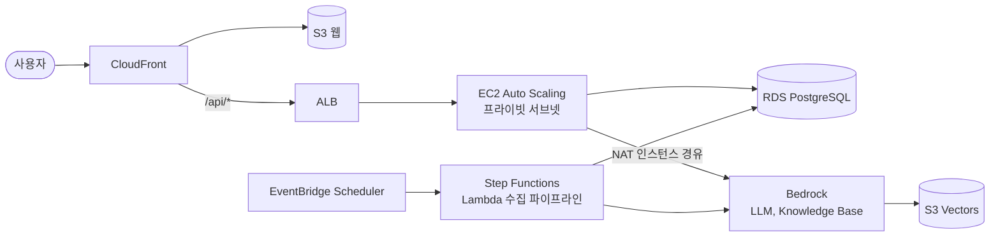

# FitJob (가칭)

> 여러 채용 사이트의 공고를 한곳에 모으고, 내 상황을 채팅으로 말하면 **조건에 맞는 공고만** 보여주는 서비스

클라우드 인프라 직무 포트폴리오 프로젝트다. 서비스 자체보다 **AWS 인프라를 설계·구축·운영하고, 그 결정과 결과를 수치로 남기는 것**이 목표다.

## 해결하려는 문제

- 직무로 검색하면 신입인데 경력 전용 공고가, 서울을 원하는데 지방 공고가 섞여 나온다.
- 채용 사이트가 흩어져 있어 같은 검색을 사이트마다 반복해야 한다.

## 해결 방법

1. 사람인 API와 공공데이터포털의 공공기관 채용정보 API로 공고를 매일 수집하고 하나의 형식으로 정리한다.
2. 사용자의 채팅에서 LLM이 조건(신입/경력, 지역, 직무 등)을 뽑는다.
3. **조건은 필터로 정확하게 거르고**, 서술형 요구만 벡터 검색으로 찾는다.

## 아키텍처 한눈에 보기

상세는 [아키텍처 구조도](docs/02-architecture.md).

## 기술 스택

| 영역 | 사용 |
|---|---|
| 엣지 | Route 53, CloudFront, ACM |
| 네트워크 | VPC(서브넷 6개, 가용영역 2곳), NAT 인스턴스 → fck-nat, S3 게이트웨이 엔드포인트 |
| 컴퓨팅 | EC2 Auto Scaling, ALB, ECR, Docker |
| 데이터 | RDS PostgreSQL, S3 |
| AI | Amazon Bedrock (Claude Haiku 5.5, Knowledge Base), S3 Vectors |
| 파이프라인 | EventBridge Scheduler, Step Functions, Lambda |
| 운영 | CloudWatch, SNS, AWS Budgets, Secrets Manager, SSM |
| IaC·CI/CD | Terraform, GitHub Actions(OIDC) |
| 앱 | Python FastAPI, React |
| 테스트 | pytest, Playwright, k6, 자체 RAG 평가셋 |

## 핵심 결정

| 결정 | 이유 |
|---|---|
| 공식 API만 사용, 크롤링 안 함 | 법적 위험 제거 ([ADR-001](docs/10-adr.md#adr-001-공식-api와-공공데이터만-사용한다)) |
| 두 번째 소스는 공공기관 채용정보 API | 고용24 채용정보는 개인 신청으로 받을 수 없음 ([ADR-013](docs/10-adr.md#adr-013-두-번째-수집-소스로-공공기관-채용정보-조회서비스를-쓴다)) |
| 벡터 저장소는 S3 Vectors | OpenSearch Serverless의 상시 비용(월 약 $350) 대신 월 $1 미만 ([ADR-002](docs/10-adr.md#adr-002-벡터-저장소로-bedrock-knowledge-base--s3-vectors를-쓴다)) |
| 하드 조건은 메타데이터 필터 | 조건 위반 공고를 구조적으로 차단 ([ADR-003](docs/10-adr.md#adr-003-하드-조건은-필터-서술형-요구는-벡터-검색으로-처리한다)) |
| NAT 인스턴스 | NAT Gateway 대비 비용 절감, 단일 장애점은 장애 훈련으로 검증·개선 ([ADR-005](docs/10-adr.md#adr-005-nat-gateway-대신-nat-인스턴스를-쓴다)) |
| 콘솔로 구축 후 Terraform으로 가져오기 | 콘솔로 서비스를 익힌 뒤 `import`로 코드화하고 destroy·apply로 재현 검증 ([ADR-012](docs/10-adr.md#adr-012-인프라를-콘솔로-먼저-만들고-terraform으로-가져온다)) |
| Terraform 스택 9개 | 상시 5, 온디맨드 4로 나눠 필요한 것만 켜고 끄기 ([ADR-007](docs/10-adr.md#adr-007-처음부터-terraform으로-관리하고-스택을-나눈다)) |
| 개발 기간 온디맨드 운영 | 고정비 대부분을 작업 시간에만 지불, 월 $95 → $15~35 ([ADR-011](docs/10-adr.md#adr-011-개발-기간에는-비싼-리소스를-온디맨드로-운영한다)) |

## 문서

| 문서 | 내용 |
|---|---|
| [01. 요구사항 명세서](docs/01-requirements.md) | 목표, 범위, 기능·비기능 요구사항, 미결 사항 |
| [02. 아키텍처 구조도](docs/02-architecture.md) | 전체·네트워크·파이프라인·채팅·배포 다이어그램, 장애 영향, 비용 |
| [03. DB 스키마](docs/03-db-schema.md) | ERD, 테이블 명세, DDL, S3·KB 문서 구조, 보존 정책 |
| [04. API 명세](docs/04-api-spec.md) | 엔드포인트, 요청·응답, 오류, 조건 추출 스키마 |
| [05. 인프라 명세](docs/05-infrastructure.md) | 서브넷, 라우팅, 보안 그룹, IAM, Terraform 구조, 온디맨드 운영, 콘솔 구축 후 Terraform으로 가져오기 |
| [06. CI/CD](docs/06-cicd.md) | 워크플로, 품질 게이트, OIDC, 배포·롤백 |
| [07. 테스트 전략](docs/07-test-plan.md) | 데이터 품질 규칙, RAG 평가, 부하 테스트, 장애 훈련 |
| [08. 운영](docs/08-operations.md) | SLO, 대시보드, 알람, 런북, 백업, 보고서 양식 |
| [09. 로드맵](docs/09-roadmap.md) | 14주 일정, 단계별 완료 기준, 위험 관리 |
| [10. ADR](docs/10-adr.md) | 아키텍처 결정 기록 13건 |
| [하네스](docs/harness.md) | Claude Code 권한·훅·검증 규칙, 단계별 구축 순서 |

## 현재 상태

설계 완료, 구현 전 (2026-11-04). 진행 상황은 [로드맵](docs/09-roadmap.md)을 따른다.

| 항목 | 상태 |
|---|---|
| 설계 문서 | 01~10 v0.2 완료. 코드는 아직 없다 |
| 수집 소스 | 공공데이터포털 공공기관 채용정보 API 키 활성화(2026-11-03, 진행 중 공고 527건 확인). 사람인 API는 심사 중 |
| 개발 환경 | WSL(Ubuntu 24.04)에 make·Terraform·AWS CLI·Session Manager 플러그인 설치, Docker WSL 연동 확인(2026-11-04) |
| 진행 중 | [Phase 0 준비](docs/09-roadmap.md#phase-0-준비-w1)를 2026-11-04에 앞당겨 시작. 끝낸 것: 계정 보안(루트·작업용 사용자 MFA), WSL에서 AWS CLI 로그인, 이 저장소와 하네스(권한 설정·문서 링크 검사 훅), Q-06(Terraform이 S3 Vectors·KB 지원). 남은 것: Terraform import 연습, Q-03·Q-04·Q-05. 기록은 [완료 기록](docs/09-roadmap.md#7-완료-기록) |
