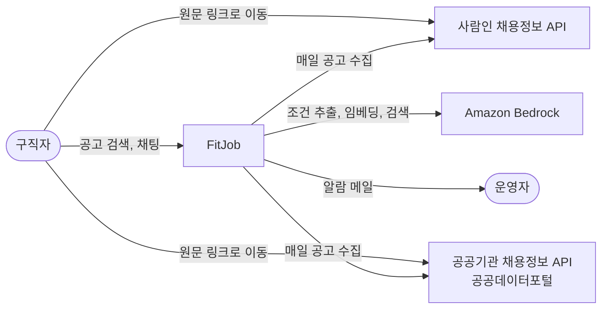
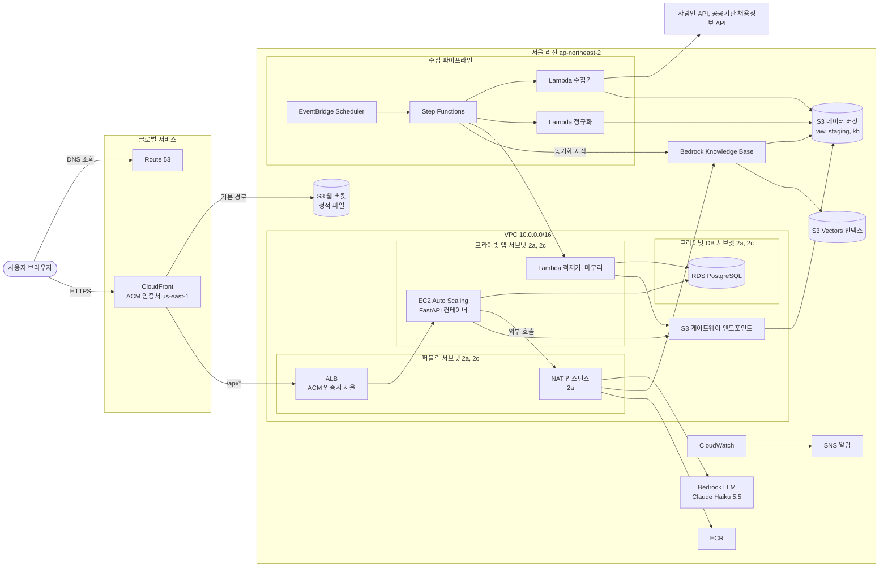
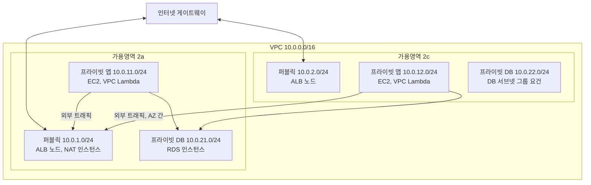
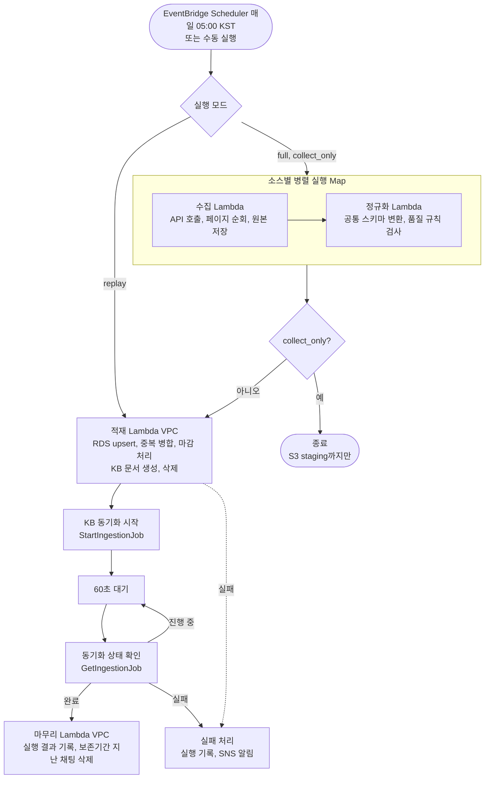
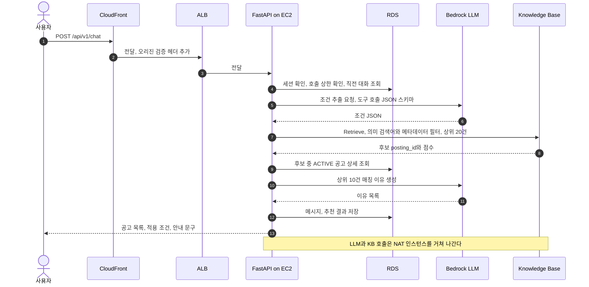
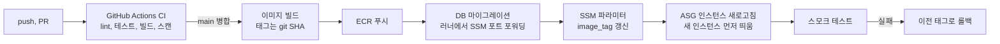

# 02. 아키텍처 구조도

| 항목 | 내용 |
|---|---|
| 문서 버전 | v0.2 |
| 작성일 | 2026-11-02 |
| 변경 | 개발 기간 온디맨드 운영 반영 (2026-11-02) |
| 변경 | 기존 문제 수정: DB 관리 작업 접속, E2E·보안 회귀 워크플로, RAG 평가 방식 (2026-11-02) |
| 변경 | 수집 전용(`collect_only`) 모드 추가, Phase 2 RDS 상시 이유 명시 (2026-11-02) |
| 변경 | 콘솔 구축 후 Terraform으로 가져오는 방식(ADR-012), 일정 14주 (2026-11-02) |
| 변경 | Phase 2 DB 접속용 임시 EC2 추가 (2026-11-03) |
| 변경 | 두 번째 소스를 공공기관 채용정보 조회서비스로 변경(ADR-013) (2026-11-03) |
| 관련 문서 | [인프라 명세](05-infrastructure.md), [ADR](10-adr.md) |

> 다이어그램은 Mermaid로 작성했다. GitHub에서 바로 렌더링된다. 포트폴리오용 이미지는 구현 후 AWS 아이콘으로 다시 그린다.

---

## 1. 설계 원칙

1. **프라이빗이 기본값.** 앱 서버와 DB는 인터넷에서 직접 닿지 않는다. 들어오는 길은 CloudFront → ALB 하나뿐이다.
2. **비용을 설계 변수로 다룬다.** 상시 과금 리소스(NAT, 벡터 DB, 클러스터)는 대안과 비교해 고른다.
3. **상시 트래픽은 EC2, 짧은 배치는 서버리스.** 채팅 API는 EC2 Auto Scaling, 하루 한 번 도는 수집은 Lambda와 Step Functions.
4. **모든 것은 코드.** AWS 리소스는 전부 Terraform으로 관리한다. 학습을 위해 콘솔로 먼저 만들어 보고 Terraform으로 가져오며([ADR-012](10-adr.md#adr-012-인프라를-콘솔로-먼저-만들고-terraform으로-가져온다)), 가져온 뒤의 콘솔 수동 변경은 드리프트로 간주한다.
5. **장애를 전제로 한다.** 단일 장애점은 숨기지 않고 문서화하며, 장애 훈련으로 복구 시간을 측정한다.
6. **쓰는 시간만 비용을 낸다.** 개발 기간에는 시간당 과금되는 리소스(NAT, RDS, ALB, 앱 서버)를 온디맨드 스택으로 묶어 작업할 때만 켜고 끈다([ADR-011](10-adr.md#adr-011-개발-기간에는-비싼-리소스를-온디맨드로-운영한다)).

## 2. 시스템 컨텍스트

## 3. 전체 AWS 아키텍처

### 3.1 요청 경로 요약

| 경로 | 흐름 |
|---|---|
| 웹 화면 | 브라우저 → CloudFront → S3 웹 버킷(OAC) |
| API | 브라우저 → CloudFront `/api/*` → ALB(퍼블릭) → EC2(프라이빗) → RDS |
| 채팅의 AI 호출 | EC2 → NAT 인스턴스 → 인터넷 게이트웨이 → Bedrock(LLM, KB) |
| 수집 | Scheduler → Step Functions → 수집 Lambda(VPC 밖) → 외부 API, S3 |
| 적재 | Step Functions → 적재 Lambda(VPC 안) → RDS, S3(게이트웨이 엔드포인트) |
| 동기화 | Step Functions → KB 동기화 → S3 `kb/` 읽기 → 임베딩 → S3 Vectors |

## 4. 네트워크 구조

- 서브넷은 6개다. 가용영역 2곳 × (퍼블릭, 프라이빗 앱, 프라이빗 DB).
- DB 서브넷 그룹은 가용영역 2곳 이상의 서브넷을 요구하므로, Single-AZ RDS라도 2c에 DB 서브넷을 만든다.
- 프라이빗 서브넷의 외부 트래픽은 모두 2a의 NAT 인스턴스로 간다. S3 트래픽은 게이트웨이 엔드포인트로 NAT를 우회한다(무료).
- NAT 인스턴스와 앱 라우팅 테이블의 기본 경로(`0.0.0.0/0`)는 온디맨드 `nat` 스택이 만든다. NAT가 꺼져 있으면 프라이빗 서브넷은 S3를 빼고 외부와 통신하지 않는다.
- CIDR, 라우팅 테이블, 보안 그룹 상세는 [인프라 명세](05-infrastructure.md) 참고.

## 5. 데이터 수집 파이프라인

| 단계 | 실행 위치 | 입력 → 출력 | 실패 처리 |
|---|---|---|---|
| 수집 | Lambda, VPC 밖 | 외부 API → `s3://.../raw/{source}/dt={날짜}/` | 지수 백오프 3회 재시도 |
| 정규화 | Lambda, VPC 밖 | `raw/` → `staging/`(정상), `quarantine/`(규칙 위반) | 재시도 2회 |
| 적재 | Lambda, VPC 안 | `staging/` → RDS, `kb/postings/` | 재시도 2회, 트랜잭션 단위 커밋 |
| KB 동기화 | Step Functions SDK 통합 | `kb/` → S3 Vectors | 상태 폴링, 실패 시 알림 |
| 마무리 | Lambda, VPC 안 | 실행 결과 → `ingestion_runs` | 실패해도 서비스 영향 없음, 알림 |

설계 포인트:

- **소스 하나가 실패해도 나머지는 진행한다.** Map 상태의 허용 실패 비율을 설정하고, 실행 결과를 `PARTIAL`로 기록한 뒤 알린다.
- **외부 API 호출은 VPC 밖 Lambda가 한다.** NAT가 멈춰도 수집은 계속된다. RDS에 써야 하는 적재·마무리 Lambda만 VPC 안에 둔다.
- **멱등성.** 원본은 실행 ID별 경로에 저장하고, 적재는 `(source_id, source_posting_id)` 기준 upsert라서 같은 날짜를 다시 돌려도 중복이 생기지 않는다.
- **바뀐 공고만 KB에 반영한다.** `content_hash`와 `kb_synced_hash`를 비교해 변경분만 `kb/`에 쓰고, 마감 공고 문서는 지운다. KB 동기화는 S3의 추가·변경·삭제를 반영한다(구현 시 동작 확인).
- **DB 주소는 실행할 때 읽는다.** 적재·마무리 Lambda는 `database` 스택이 기록한 SSM 파라미터 `/fitjob/prod/db/endpoint`에서 RDS 주소를 읽는다. 상시 스택인 `pipeline`이 온디맨드 스택인 `database`를 Terraform으로 참조하지 않게 하기 위해서다.

실행 방식:

| 항목 | 내용 |
|---|---|
| 예약 실행 | 매일 05:00 KST. Terraform 변수 `schedule_mode`로 모드를 정한다: `collect_only`(개발 기간 기본), `full`(운영 단계), `off`(예약 실행 없음) |
| 수동 실행 | 필요할 때 `aws stepfunctions start-execution`으로 실행한다. `full`·`replay`는 적재 Lambda가 NAT를 거쳐 Secrets Manager에 접근하고 RDS에 쓰므로 `nat`·`database` 스택이 켜져 있어야 한다 |

실행 모드:

| 모드 | 입력 | 하는 일 | 필요한 온디맨드 스택 | 쓰는 때 |
|---|---|---|---|---|
| `full` (기본) | `{"run_date": "YYYY-MM-DD"}` | 수집 → 정규화 → 적재 → KB 동기화 → 마무리 | `nat`, `database` | 운영 단계 예약 실행, 개발 중 통합 확인 |
| `collect_only` | `{"mode": "collect_only", "run_date": "YYYY-MM-DD"}` | 수집 → 정규화까지만. S3 `raw/`·`staging/`·`quarantine/`에 쌓고 끝낸다 | 없음 | 개발 기간 예약 실행 |
| `replay` | `{"mode": "replay", "run_date": "YYYY-MM-DD"}` | 수집·정규화를 건너뛰고 S3 `staging/`의 해당 날짜 파일로 적재부터 실행 | `nat`, `database` | RDS를 새로 만든 뒤 다시 채우기, 적재 장애 복구, 쌓아둔 날짜를 순서대로 적재([DB 스키마 6.6](03-db-schema.md#66-재적재replay)) |

**수집 전용(`collect_only`) 모드를 두는 이유:**
- 수집·정규화 Lambda는 VPC 밖에 있어 NAT·RDS가 꺼져 있어도 돈다. 비용은 하루 한 번 Lambda 실행과 S3 저장뿐이라 거의 들지 않는다.
- 개발 중에도 매일 실제 API 응답이 S3에 쌓인다. replay할 최신 데이터가 늘 있어서 `staging/` 30일 보관 기간이 지나 replay할 데이터가 없어지는 일이 생기지 않는다.
- 쌓인 날짜들을 작업할 때 순서대로 replay하면 매일 적재한 것과 같은 상태가 된다. 마감 처리처럼 여러 날에 걸친 로직을 NAT를 밤새 켜두지 않고도 확인할 수 있다.
- RDS에는 기록을 남기지 않는다(`ingestion_runs` 등은 적재 단계가 쓰기 때문). 결과는 Step Functions 실행 기록, S3 파일, CloudWatch 지표(`FetchedCount`, `QuarantinedCount`)로 확인하고, 실패하면 공용 SNS 토픽으로 알림이 온다.

## 6. 채팅 검색 흐름

- **하드 조건은 필터, 서술형 요구는 벡터 검색.** 경력·지역·직무·마감은 메타데이터 필터로 걸러 조건 위반을 원천 차단한다([ADR-003](10-adr.md)).
- **RDS가 최종 기준이다.** KB 동기화가 늦어도 RDS에서 `ACTIVE`가 아닌 공고는 결과에서 뺀다.
- **응답 시간 예산(p95 6초):** 조건 추출 1.5초, KB 검색 1초, DB 0.1초, 이유 생성 2.5초, 여유 0.9초.
- **LLM 실패 시 대체 경로:** 조건 추출이 실패하면 입력 문장을 키워드로 써서 RDS 목록 검색 결과를 돌려주고 `status = DEGRADED`로 표시한다. 이유 생성(10번)이 실패하면 응답은 `OK`로 두고, 매칭 이유만 공고 필드로 만든 템플릿 문장으로 대체한다. 쓰로틀링이 계속되면 SSM 파라미터 `reasons_mode`를 `template`로 바꿔 이유 생성 LLM 호출을 아예 건너뛴다([API 명세 5.4](04-api-spec.md#54-매칭-이유-생성)).
- **외부 호출 제한 시간:** Bedrock 호출은 연결 2초, 읽기 10초, 재시도 2회로 제한한다. 기본값을 쓰면 NAT 장애 때 요청이 수십 초씩 붙잡혀 서버 작업자가 고갈된다.

## 7. 배포 흐름

새 인스턴스는 부팅할 때 SSM 파라미터에서 이미지 태그를 읽어 컨테이너를 띄운다. 인스턴스 새로고침은 새 인스턴스를 먼저 띄워 정상 판정을 받은 뒤 기존 인스턴스를 내린다(최소 정상 100%, 최대 정상 200%). 그래서 운영 기본 구성처럼 앱 서버가 1대여도 무중단 배포가 된다. `app` 스택이 꺼져 있으면 이미지 빌드·푸시와 태그 갱신까지만 하고, 다음 `make up` 때 새 태그로 뜬다. 상세는 [CI/CD](06-cicd.md) 참고.

## 8. 구성요소 명세

스택 열의 **상시**·**온디맨드** 구분은 [인프라 명세 10.2](05-infrastructure.md#102-스택-구성과-적용-순서) 참고.

| 영역 | 구성요소 | AWS 서비스 | 사양·설정 | 스택 |
|---|---|---|---|---|
| 엣지 | DNS | Route 53 | 호스팅 영역 1개, `app`·`origin` 레코드, 헬스체크 1개 | edge (`origin` 레코드는 app, 헬스체크는 observability) |
| 엣지 | CDN | CloudFront | 오리진 2개(S3, `origin.<도메인>`), `/api/*` 캐시 끔 | edge |
| 엣지 | 인증서 | ACM | us-east-1(CloudFront용), ap-northeast-2(ALB용) | edge |
| 웹 | 정적 호스팅 | S3 | 퍼블릭 차단, OAC로만 접근 | storage |
| 네트워크 | VPC | VPC | 10.0.0.0/16, 서브넷 6개, IGW 1개, 보안 그룹 전부 | network |
| 네트워크 | NAT | EC2 | t4g.nano, 처음엔 직접 구성 → fck-nat 고가용성 모드([ADR-005](10-adr.md#adr-005-nat-gateway-대신-nat-인스턴스를-쓴다)) | nat |
| 네트워크 | 엔드포인트 | VPC 엔드포인트 | S3 게이트웨이(무료) | network |
| 컴퓨팅 | 로드밸런서 | ALB | HTTPS 443, CloudFront 접두사 목록만 허용 | app |
| 컴퓨팅 | 앱 서버 | EC2 + Auto Scaling | t3.micro(`app_instance_type`), 용량 변수화(운영 기본 1~4대, 훈련 시 최소 2대), 가용영역 2곳 서브넷 | app |
| 컴퓨팅 | 컨테이너 저장소 | ECR | 태그 불변, 푸시 시 스캔 | storage |
| 데이터 | 관계형 DB | RDS PostgreSQL | db.t4g.micro, Single-AZ(2a), gp3 20GB, 백업 7일 | database |
| 데이터 | DB 접속 경유지 | EC2 | t4g.nano, app-2a, 퍼블릭 IP 없음. Phase 2에만 둔다(앱 서버가 생기면 삭제, [인프라 명세 8.5](05-infrastructure.md#85-db-접속용-임시-ec2-phase-2)) | nat |
| 데이터 | 객체 저장소 | S3 | 데이터 버킷(raw, staging, quarantine, kb) | storage |
| AI | RAG | Bedrock Knowledge Base | S3 데이터 소스, 분할 없음(공고 1건 = 문서 1개) | storage |
| AI | 벡터 저장소 | S3 Vectors | 1024차원, 코사인 거리 | storage |
| AI | LLM | Bedrock | Claude Haiku 5.5 | 해당 없음(모델 접근만 활성화) |
| 파이프라인 | 스케줄 | EventBridge Scheduler | 매일 05:00 Asia/Seoul, `schedule_mode`로 모드 지정(개발 `collect_only`, 운영 `full`) | pipeline |
| 파이프라인 | 오케스트레이션 | Step Functions | 표준 워크플로, `full`·`collect_only`·`replay` 모드 | pipeline |
| 파이프라인 | 작업 | Lambda | 수집, 정규화(VPC 밖), 적재, 마무리(VPC 안) | pipeline |
| 보안 | 비밀정보 | Secrets Manager | 시크릿 5개: RDS 마스터(RDS 관리), DB 마이그레이션 사용자, DB 앱 사용자, API 키, 오리진 검증 값 | storage (RDS 마스터는 database와 함께 생성·삭제) |
| 보안 | 설정 | SSM Parameter Store | 이미지 태그, 앱 설정, DB 주소 | storage (DB 주소는 database) |
| 운영 | 관측 | CloudWatch | 지표, 로그, 대시보드, 알람 | observability (로그 그룹은 storage·pipeline) |
| 운영 | 알림 | SNS | 이메일 구독. 공용 토픽(서울), Route 53 헬스체크용 토픽(us-east-1) | bootstrap (us-east-1 토픽은 observability) |
| 운영 | 비용 | AWS Budgets | 월 $100, 50/80/100% 알림 | bootstrap |

## 9. 도메인과 인증서

| 호스트 | 가리키는 곳 | 인증서 |
|---|---|---|
| `app.<도메인>` | CloudFront 배포 | ACM **us-east-1** (CloudFront는 이 리전 인증서만 사용) |
| `origin.<도메인>` | ALB | ACM **ap-northeast-2** |

- 사용자는 `app.<도메인>` 하나만 쓴다. 웹과 API가 같은 도메인이라 CORS 설정이 필요 없다.
- CloudFront는 `origin.<도메인>`으로 ALB에 HTTPS로 접속한다. ALB DNS 이름은 다시 만들 때마다 바뀌므로 `origin` 레코드는 `app` 스택에 둬서 ALB와 함께 생성·삭제한다. CloudFront 설정은 바꿀 필요가 없다.
- **ALB 보호 2단계:** (1) ALB 보안 그룹은 CloudFront 오리진용 관리형 접두사 목록만 허용한다. (2) CloudFront가 비밀 헤더(`X-Origin-Verify`)를 붙이고, ALB 리스너 규칙은 이 헤더가 맞을 때만 전달하며 나머지는 403을 돌려준다([ADR-009](10-adr.md)).
- ALB 인증서와 `origin` 레코드가 도메인을 전제로 하므로, 도메인은 Phase 3에서 `app`·`edge` 스택을 만들기 전에 산다. 그 전에는 로컬(docker compose)에서 API를 개발한다.

## 10. 장애 영향 분석

| 장애 | 영향 | 감지 | 대응 |
|---|---|---|---|
| NAT 인스턴스 중단 | 채팅 불가(Bedrock 호출 실패), 적재 Lambda 실패. **목록 조회는 정상** | Route 53 헬스체크(`/api/health/deep`), NAT 상태 검사 알람 | 1단계: 수동 교체 / 2단계: fck-nat ASG 자동 복구 |
| 앱 인스턴스 1대 중단 | 1대 운영 시(운영 기본): ASG가 교체하는 수 분간 API 중단 / 2대 운영 시(훈련 기간): 영향 없음(다른 가용영역이 처리) | ALB `UnHealthyHostCount`, `HealthyHostCount` | ASG가 자동 교체 |
| 가용영역 2a 전체 장애 | NAT·RDS가 함께 멈춰 **서비스 중단** | 위 알람 전체 | RDS를 스냅샷·시점 복구로 2c에 복원. 수용한 위험([ADR-006](10-adr.md)) |
| RDS 장애·재부팅 | 목록·채팅 모두 실패 | RDS 이벤트, DB 연결 오류 알람 | 자동 재시작 대기, 필요 시 시점 복구 |
| Bedrock 쓰로틀링·장애 | 채팅 품질 저하 | Bedrock 쓰로틀 지표, 앱 오류율 | 재시도·백오프, 키워드 검색 대체 응답 |
| 외부 API 장애·응답 형식 변경 | 신규 공고 미반영(기존 데이터 유지) | 수집 실패 알람, 수집 건수 급감 알람 | 원인 확인 후 재실행, 정규화 코드 수정 |
| KB 동기화 실패 | 채팅 결과가 하루 전 데이터 기준(마감 공고는 RDS에서 걸러짐) | 동기화 실패 알람 | 동기화 재실행 |
| 잘못된 배포 | 신규 인스턴스 헬스체크 실패 | 인스턴스 새로고침 실패, 스모크 테스트 실패, 5xx 알람 | 파이프라인이 이전 태그로 되돌리고 새로고침 재실행 |

**알려진 단일 장애점:** NAT 인스턴스(2a), RDS Single-AZ(2a). 둘 다 같은 가용영역에 둬서 "2c 장애는 무영향, 2a 장애는 전체 영향"으로 단순화했다. 운영 기본 구성(앱 서버 1대)에서는 앱 서버도 단일 장애점이며, ASG 자동 교체로 수 분 안에 복구한다. 모두 비용과 맞바꾼 결정이며 확장 시나리오에서 해소한다.

개발 기간에 온디맨드 스택(`nat`, `database`, `app`)이 꺼져 있으면 웹 화면은 S3에서 그대로 뜨지만 `/api/*`는 오리진이 없어 오류(502)를 돌려준다. 장애가 아니라 의도된 상태다.

## 11. 비용 추정 (서울 리전, 월)

### 11.1 24시간 가동 시 서비스별 비용

앱 서버 2대로 24시간 켜뒀을 때의 값이다. 대부분이 사용량과 관계없이 시간당 과금되는 고정비다.

| 항목 | 산정 근거 | 구분 | 스택 | 월 예상 |
|---|---|---|---|---|
| ALB | 시간 요금 + 저트래픽 LCU | 고정 | app | ~$20 |
| EC2 앱 서버 | t3.micro × 2 | 고정 | app | ~$21 |
| RDS | db.t4g.micro Single-AZ + gp3 20GB | 고정 | database | ~$21 |
| 퍼블릭 IPv4 | ALB 2개 + NAT 1개, 개당 시간당 $0.005 | 고정 | app, nat | ~$11 |
| NAT 인스턴스 | t4g.nano + EBS | 고정 | nat | ~$4 |
| 앱 서버 EBS | gp3 16GB × 2 | 고정 | app | ~$3 |
| CloudWatch | 로그, 사용자 지표, 대시보드, 알람 | 반고정 | observability 외 | ~$5 |
| Secrets Manager | 시크릿 5개 | 고정 | storage, database | ~$2 |
| Route 53 | 호스팅 영역 + 헬스체크 | 고정 | edge, observability | ~$2 |
| 도메인 | .com 연 $16 | 고정 | 해당 없음 | ~$1.3 |
| ECR | 이미지 저장 | 사용량 | storage | ~$0.5 |
| S3, S3 Vectors, KB | 데이터 수 GB 이하 | 사용량 | storage | ~$1 |
| Lambda, Step Functions | 일 1회 실행 | 사용량 | pipeline | ~$1 |
| Bedrock | LLM + 임베딩, 채팅 일 1,000회 이하 | 사용량 | 해당 없음 | $1~10 |
| CloudFront | 무료 사용량 범위 | 사용량 | edge | ~$0 |
| **합계** | | | | **약 $94~103** |

- **켜져 있는 동안의 시간당 비용:** 약 $0.11(RDS 포함), RDS를 빼면 약 $0.08. 온디맨드 스택의 고정비(ALB, EC2, RDS, 퍼블릭 IPv4, NAT, 앱 서버 EBS = 월 약 $80, RDS 제외 약 $59)를 730시간으로 나눈 값이다(앱 서버 2대 기준).
- **대기 비용:** 상시 스택만 켜둔 상태는 월 약 $5다(Secrets Manager, Route 53 호스팅 영역, 도메인, ECR, S3·KB 저장).

### 11.2 단계별 예상 비용

개발 기간에는 시간당 과금 리소스를 온디맨드로 운영한다([ADR-011](10-adr.md#adr-011-개발-기간에는-비싼-리소스를-온디맨드로-운영한다)).

| 기간 | 단계 | 운영 방식 | 월 예상 |
|---|---|---|---|
| W1~4 | 준비, 기반 인프라 | 상시 스택만, `nat`는 작업할 때만 | 약 $5 |
| W5~6 | 데이터 파이프라인 | RDS 상시, `nat`(DB 접속용 임시 EC2 포함)는 작업할 때만 | 약 $25~30 |
| W7~11 | API·웹, CI/CD, 관측·보안 | 하루 4시간 작업 기준 온디맨드 | 약 $15~35 (RDS를 같이 끄면 $15, 계속 켜두면 $35) |
| W12~14 | 운영·검증, 정리 | 24시간 운영, 앱 서버 1대 | 약 $82~91 (VPC 오리진 전환 시 약 $75~84) |
| **14주 총액** | | | **약 $90~135** |

- 운영 단계 비용은 11.1의 24시간 합계에서 앱 서버 1대분(EC2 + EBS 약 $12)을 뺀 값이다. 범위는 Bedrock 사용량($1~10) 차이다.
- 14주 총액의 계산값은 약 $90~120이다. 부하 테스트·장애 훈련 기간의 앱 서버 2대 운영과 Bedrock 사용량 변동을 고려해 위쪽에 여유를 뒀다.
- 기존 계획처럼 단계마다 만든 리소스를 24시간 켜두면 14주 총액은 약 $195~210다(W1 약 $0, W2~4 NAT만 월 약 $8, W5~6 RDS 추가 월 약 $35, W7~14 전체 월 $94~103).
- 콘솔로 만든 리소스는 Terraform으로 가져오기 전에는 `make down`이 지우지 못하므로, 만든 날 가져오거나 직접 지운다는 전제다([인프라 명세 13.2](05-infrastructure.md#132-콘솔-단계-규칙)).

### 11.3 절감 수단

| 절감 수단 | 절감액(월) | 대가 |
|---|---|---|
| 평소 앱 서버 1대, 훈련 때만 2대 | -$12 | 평소 가용영역 이중화 없음 |
| CloudFront VPC 오리진으로 ALB 내부 전환 | -$7 | 설정 복잡도 증가(보안은 향상). Phase 5에서 검토하는 항목([ADR-009](10-adr.md#adr-009-cloudfront-단일-도메인으로-웹과-api를-제공하고-alb를-보호한다)) |
| 앱 서버 t4g 전환 | -$4 (2대 기준, 1대면 약 -$2) | arm64 이미지 빌드 필요 |
| 개발 기간 온디맨드 | 사용 시간 비례 | 켤 때마다 15~20분 |

같은 기능을 서버리스(Lambda·API Gateway·DynamoDB, NAT 없음)로 만들면 월 $5~15지만, EC2·ALB·Auto Scaling·RDS 운영 경험이 목표라 이 구성을 택했다([ADR-004](10-adr.md#adr-004-채팅-api는-ec2--alb--auto-scaling으로-운영한다)).

## 12. 확장 시나리오

| 상황 | 변경 |
|---|---|
| 채팅 트래픽 10배 | `asg_min`을 2 이상으로 올려 가용영역 이중화를 상시 유지, `asg_max` 상향, 스케일링 지표를 요청 수 기반으로, Bedrock 할당량 증설 요청 |
| NAT 의존 제거 | Bedrock·ECR·SSM·Secrets Manager 인터페이스 엔드포인트 도입(엔드포인트당 비용 발생) |
| 공격면·비용 축소 | CloudFront VPC 오리진으로 ALB를 내부(internal)로 전환, ALB 퍼블릭 IP 제거([ADR-009](10-adr.md)) |
| 가용영역 장애 대응 | 앱 서버 상시 2대(`asg_min = 2`, 월 +$12), 가용영역마다 NAT, RDS Multi-AZ (월 +$25 이상) |
| 운영 부담 감소 | 앱을 ECS Fargate로 이전 (OS 패치 불필요) |
| 로그인 기능 | Cognito 사용자 풀, 관심 공고·알림 테이블 추가 |
