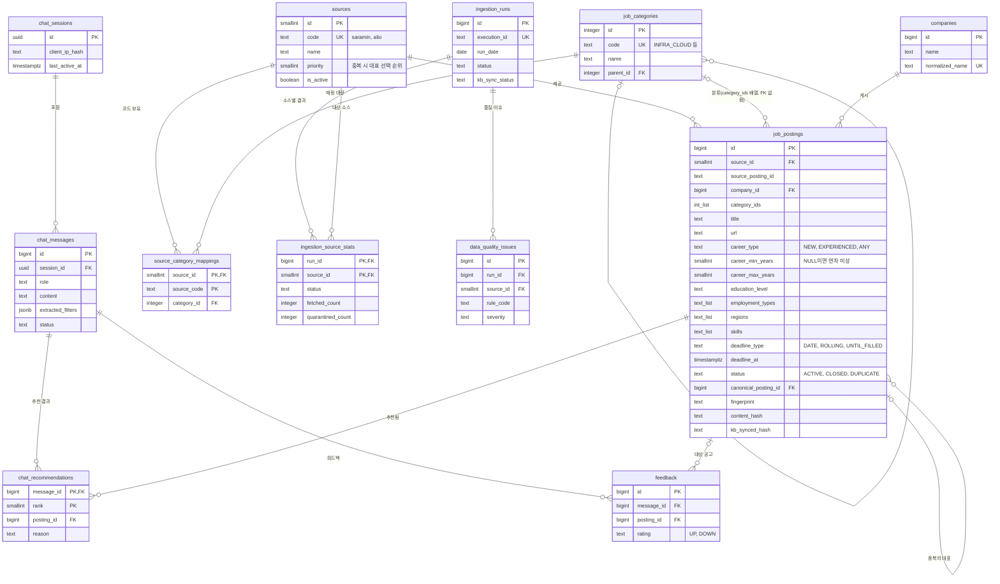

# 03. DB 스키마

| 항목 | 내용 |
|---|---|
| 문서 버전 | v0.2 |
| 작성일 | 2026-11-02 |
| 변경 | 개발 기간 온디맨드 운영 반영 (2026-11-02) |
| 변경 | 기존 문제 수정: DB 관리 작업 접속, E2E·보안 회귀 워크플로, RAG 평가 방식 (2026-11-02) |
| 변경 | 수집 전용(`collect_only`) 모드 추가, Phase 2 RDS 상시 이유 명시 (2026-11-02) |
| 변경 | 두 번째 소스를 잡알리오(공공기관 채용정보)로 변경, 잡알리오 필드 매핑 작성(ADR-013) (2026-11-03) |
| 변경 | 두 번째 소스의 표시 이름을 `잡알리오`에서 `공공데이터포털`로 변경, 소스 코드 `alio`는 유지 (2026-11-03) |
| 변경 | 공공데이터포털 코드 매핑 확정(7.1). 고용형태·직무를 배열 컬럼(`employment_types`, `category_ids`)으로, `PERMANENT_CONTRACT`(무기계약직)·`IT_GENERAL`(IT 일반) 추가, 경력 연차 미상은 NULL (2026-11-03) |
| 변경 | 9장에 KB 메타데이터 한도(1KB·키 35개)와 실측 크기, 키 없는 문서 처리 근거 추가 (2026-11-03) |
| 변경 | 연차 미상 경력 공고의 KB 메타데이터 `career_min_years`를 키 생략에서 표시값 `99`로 변경 (2026-11-04) |
| DBMS | Amazon RDS for PostgreSQL (구현 시 RDS가 지원하는 최신 메이저 버전으로 확정, 15 이상 필수) |
| 마이그레이션 도구 | Alembic |

---

## 1. 저장소 역할 분담

| 저장소 | 담는 것 | 이유 |
|---|---|---|
| RDS PostgreSQL | 정규화된 공고 원장, 코드 테이블, 수집 이력, 품질 이슈, 채팅 기록, 피드백 | 필터·정렬·집계, 트랜잭션, 제약조건으로 데이터 정합성 보장 |
| S3 데이터 버킷 | 외부 API 원본 응답, 정규화 중간 결과, 격리 데이터, KB 원본 문서 | 원본 보관(재처리 가능), KB 데이터 소스 |
| S3 Vectors (KB 관리) | 공고 문서 임베딩 + 필터용 메타데이터 | 의미 검색 |

**공고의 최종 기준은 RDS다.** KB는 검색 후보를 찾는 색인일 뿐이며, 채팅 결과는 항상 RDS에서 상태를 다시 확인한다.

## 2. ERD

> ERD의 타입은 축약 표기다(`text_list`는 `text[]`, `int_list`는 `integer[]`). 정확한 타입과 제약은 [5. DDL](#5-ddl) 참고.



## 3. 테이블 명세

### 3.1 `sources` — 채용 소스

| 컬럼 | 타입 | 제약 | 설명 |
|---|---|---|---|
| id | smallint | PK | 고정값(1 사람인, 2 공공데이터포털) |
| code | text | NOT NULL, UNIQUE | 코드에서 쓰는 식별자 |
| name | text | NOT NULL | 화면 표시명(출처 표기) |
| priority | smallint | NOT NULL, 기본 100 | 중복 공고의 대표 선택 순위(작을수록 우선) |
| is_active | boolean | NOT NULL, 기본 true | false면 수집 건너뜀 |
| created_at | timestamptz | NOT NULL | |

### 3.2 `job_categories` — 통합 직무 분류

소스마다 직무 코드 체계가 달라서 서비스 자체 분류를 두고 매핑한다.

| 컬럼 | 타입 | 제약 | 설명 |
|---|---|---|---|
| id | integer | PK, identity | |
| code | text | NOT NULL, UNIQUE | 예: `INFRA_CLOUD`, `BACKEND` |
| name | text | NOT NULL | 예: 클라우드·인프라 |
| parent_id | integer | FK → job_categories | 상위 분류(선택) |
| sort_order | integer | NOT NULL, 기본 0 | 화면 정렬 |

### 3.3 `source_category_mappings` — 소스 직무 코드 매핑

| 컬럼 | 타입 | 제약 | 설명 |
|---|---|---|---|
| source_id | smallint | PK, FK → sources | |
| source_code | text | PK | 소스의 직무 코드 |
| source_name | text | | 소스의 직무명(참고용) |
| category_id | integer | NOT NULL, FK → job_categories | 매핑된 통합 분류 |

공고 하나에 소스 직무 코드가 여러 개면 코드마다 변환해 `job_postings.category_ids`에 중복 없이 넣는다. 매핑에 없는 코드는 빼고 품질 이슈(`CATEGORY_UNMAPPED`, WARN)를 남긴다. 남는 코드가 없으면 `category_ids = {}`로 적재한다.

### 3.4 `companies` — 회사

| 컬럼 | 타입 | 제약 | 설명 |
|---|---|---|---|
| id | bigint | PK, identity | |
| name | text | NOT NULL | 처음 수집된 표기 |
| normalized_name | text | NOT NULL, UNIQUE | 법인 표기·공백 제거, 소문자화 ([6.3](#63-중복-판정)) |
| created_at | timestamptz | NOT NULL | |

### 3.5 `job_postings` — 공고 (핵심 테이블)

| 컬럼 | 타입 | 제약 | 설명 |
|---|---|---|---|
| id | bigint | PK, identity | 서비스 내부 ID, KB 문서 ID로도 사용 |
| source_id | smallint | NOT NULL, FK | |
| source_posting_id | text | NOT NULL | 소스의 공고 ID |
| company_id | bigint | NOT NULL, FK | |
| category_ids | integer[] | NOT NULL, 기본 `{}` | 통합 직무 분류 ID 목록, 매핑 실패 시 빈 배열. 배열이라 FK를 걸 수 없어 적재 Lambda가 `job_categories`에 있는 ID만 넣는다 |
| title | text | NOT NULL | |
| url | text | NOT NULL | 원문 링크 |
| career_type | text | NOT NULL, CHECK | `NEW` 신입만, `EXPERIENCED` 경력만, `ANY` 신입 가능(경력무관, 신입·경력) |
| career_min_years | smallint | 기본 0, CHECK | 최소 경력 연수. 연차를 알 수 없는 경력 공고(`EXPERIENCED`)만 NULL이고, KB 메타데이터에는 표시값 `99`로 넣는다([9](#9-kb-문서-형식)). 연차를 말한 검색에서 빠진다([7.1](#71-공공데이터포털-코드-매핑)) |
| career_max_years | smallint | | 최대 경력 연수, 상한 없으면 NULL |
| education_level | text | NOT NULL, 기본 `ANY` | 최소 학력 |
| employment_types | text[] | NOT NULL, 기본 `{}`, CHECK | 고용 형태 목록, 매핑 실패 시 빈 배열 |
| regions | text[] | NOT NULL, 기본 `{}` | 표준 시·도명 목록, 전국 근무는 `전국` |
| location_text | text | | 원문 근무지 표기 |
| salary_text | text | | 원문 급여 표기 |
| salary_min_10k, salary_max_10k | integer | | 연봉(만원), 파싱 가능할 때만 |
| skills | text[] | NOT NULL, 기본 `{}` | 기술 키워드 |
| summary | text | | KB 문서 본문으로 쓰는 요약·발췌 |
| posted_at | timestamptz | | 게시일 |
| deadline_type | text | NOT NULL, CHECK | `DATE` 마감일 있음, `ROLLING` 상시, `UNTIL_FILLED` 채용 시 마감 |
| deadline_at | timestamptz | | `DATE`이면 필수 |
| status | text | NOT NULL, 기본 `ACTIVE` | `ACTIVE`, `CLOSED`, `DUPLICATE` |
| canonical_posting_id | bigint | FK → job_postings | `DUPLICATE`일 때 대표 공고 |
| fingerprint | char(64) | NOT NULL | 소스 간 중복 판정용 SHA-256 |
| content_hash | char(64) | NOT NULL | 검색에 쓰는 필드의 해시(변경 감지) |
| kb_synced_hash | char(64) | | KB에 마지막으로 반영한 content_hash, KB에 없으면 NULL |
| raw_s3_key | text | NOT NULL | 마지막 원본 위치(추적용) |
| first_seen_at, last_seen_at | timestamptz | NOT NULL | 처음·마지막 수집 시각 |
| closed_at | timestamptz | | 마감 처리 시각 |
| created_at, updated_at | timestamptz | NOT NULL | `updated_at`은 트리거로 갱신 |

### 3.6 `ingestion_runs` — 수집 실행

| 컬럼 | 타입 | 제약 | 설명 |
|---|---|---|---|
| id | bigint | PK, identity | |
| execution_id | text | NOT NULL, UNIQUE | Step Functions 실행 이름 |
| run_date | date | NOT NULL | 수집 기준일(KST) |
| started_at, finished_at | timestamptz | | |
| status | text | NOT NULL, CHECK | `RUNNING`, `SUCCEEDED`, `PARTIAL`, `FAILED` |
| kb_ingestion_job_id | text | | KB 동기화 작업 ID |
| kb_sync_status | text | NOT NULL, CHECK | `NOT_STARTED`, `IN_PROGRESS`, `COMPLETE`, `FAILED` |
| kb_docs_written, kb_docs_deleted | integer | NOT NULL, 기본 0 | KB 문서 쓰기·삭제 건수 |
| error_message | text | | |

### 3.7 `ingestion_source_stats` — 실행별 소스 결과

| 컬럼 | 타입 | 설명 |
|---|---|---|
| run_id, source_id | PK, FK | |
| status | text | `SUCCEEDED`, `FAILED`, `SKIPPED` |
| fetched_count | integer | API에서 받은 건수 |
| inserted_count, updated_count | integer | 신규·변경 건수 |
| closed_count, duplicate_count | integer | 마감·중복 처리 건수 |
| quarantined_count | integer | 품질 규칙 위반으로 격리된 건수 |
| api_calls, duration_ms | integer | 호출 수, 소요 시간 |
| error_message | text | |

### 3.8 `data_quality_issues` — 품질 이슈

| 컬럼 | 타입 | 설명 |
|---|---|---|
| id | bigint PK | |
| run_id | FK | |
| source_id | FK | |
| source_posting_id | text | 해당 레코드 |
| rule_code | text | 규칙 ID ([테스트 전략](07-test-plan.md#3-데이터-품질-규칙)) |
| severity | text | `ERROR`(적재 제외), `WARN`(적재하고 기록) |
| detail | jsonb | 위반 필드, 값 |
| created_at | timestamptz | |

### 3.9 `chat_sessions` — 익명 채팅 세션

| 컬럼 | 타입 | 설명 |
|---|---|---|
| id | uuid PK | 서버가 발급 |
| client_ip_hash | char(64) | 솔트를 섞은 IP 해시(원본 IP 미저장), IP별 호출 제한에 사용 |
| user_agent | text | 앞 256자만 |
| created_at, last_active_at | timestamptz | 보존 기간 계산 기준 |

### 3.10 `chat_messages` — 채팅 메시지

| 컬럼 | 타입 | 설명 |
|---|---|---|
| id | bigint PK | |
| session_id | uuid FK | 세션 삭제 시 함께 삭제 |
| role | text | `USER`, `ASSISTANT` |
| content | text | 사용자 입력 최대 500자, 응답 최대 4,000자 |
| status | text | 응답 결과 `OK`, `NO_RESULT`, `REFUSED`, `DEGRADED`, `ERROR` (USER 메시지는 `OK`) |
| extracted_filters | jsonb | 응답 메시지에 기록하는 추출 조건 |
| model_id | text | 사용한 모델 |
| input_tokens, output_tokens | integer | 비용 추적 |
| latency_ms | integer | 응답 시간 |
| request_id | text | 로그 추적용 |
| created_at | timestamptz | |

### 3.11 `chat_recommendations` — 추천 결과

| 컬럼 | 타입 | 설명 |
|---|---|---|
| message_id, rank | PK | rank는 1~10 |
| posting_id | FK | |
| score | real | 검색 점수 |
| reason | text | 매칭 이유 한 줄 |

### 3.12 `feedback` — 피드백

| 컬럼 | 타입 | 설명 |
|---|---|---|
| id | bigint PK | |
| message_id | FK | |
| posting_id | FK | NULL이면 응답 전체에 대한 피드백 |
| rating | text | `UP`, `DOWN` |
| comment | text | 최대 500자 |
| created_at | timestamptz | |

`(message_id, posting_id)`는 NULL을 같은 값으로 보는 UNIQUE(PostgreSQL 15 이상 `NULLS NOT DISTINCT`)라서, 같은 대상에 피드백을 다시 보내면 덮어쓴다.

## 4. 코드 값

| 컬럼 | 값 |
|---|---|
| career_type | `NEW` 신입만 · `EXPERIENCED` 경력만 · `ANY` 신입도 지원 가능 |
| education_level | `ANY` 무관 · `HIGH_SCHOOL` 고졸 · `ASSOCIATE` 초대졸 · `BACHELOR` 대졸 · `MASTER` 석사 · `DOCTORATE` 박사 |
| employment_types | `FULL_TIME` 정규직 · `PERMANENT_CONTRACT` 무기계약직 · `CONTRACT` 계약직 · `INTERN` 인턴 · `PART_TIME` 시간제 (배열, 미상이면 빈 배열) |
| deadline_type | `DATE` · `ROLLING` 상시 · `UNTIL_FILLED` 채용 시 마감 |
| status | `ACTIVE` · `CLOSED` · `DUPLICATE` |
| regions | 서울, 부산, 대구, 인천, 광주, 대전, 울산, 세종, 경기, 강원, 충북, 충남, 전북, 전남, 경북, 경남, 제주, 전국, 해외 |

통합 직무 분류 초기값(시드):

| code | name | code | name |
|---|---|---|---|
| BACKEND | 백엔드 | QA | QA·테스트 |
| FRONTEND | 프론트엔드 | EMBEDDED | 임베디드·하드웨어 |
| MOBILE | 모바일 | PM | 기획·PM |
| DATA | 데이터 | DESIGN | 디자인 |
| AI_ML | AI·머신러닝 | MARKETING | 마케팅 |
| INFRA_CLOUD | 클라우드·인프라 | SALES | 영업 |
| DEVOPS_SRE | DevOps·SRE | MANAGEMENT | 경영지원 |
| SECURITY | 보안 | ETC | 기타 |
| IT_GENERAL | IT 일반 | | |

- `IT_GENERAL`은 세부 직무를 알 수 없는 IT 공고용이다(예: 공공데이터포털 NCS `정보통신`). 채팅 조건 추출 enum에는 넣지 않는다. 대신 IT 직무(BACKEND, FRONTEND, MOBILE, DATA, AI_ML, INFRA_CLOUD, DEVOPS_SRE, SECURITY, QA, EMBEDDED) 중 하나라도 검색하면 필터에 자동으로 더한다. 지역 필터에 `전국`을 함께 넣는 것과 같은 방식이다([API 명세 5.2](04-api-spec.md#52-조건--필터-변환)).

## 5. DDL

```sql
-- 확장
CREATE EXTENSION IF NOT EXISTS pg_trgm;

-- updated_at 자동 갱신
CREATE OR REPLACE FUNCTION set_updated_at() RETURNS trigger AS $$
BEGIN
    NEW.updated_at := now();
    RETURN NEW;
END;
$$ LANGUAGE plpgsql;

-- 1. 코드 테이블
CREATE TABLE sources (
    id          smallint PRIMARY KEY,
    code        text NOT NULL UNIQUE,
    name        text NOT NULL,
    priority    smallint NOT NULL DEFAULT 100,
    is_active   boolean NOT NULL DEFAULT true,
    created_at  timestamptz NOT NULL DEFAULT now()
);

CREATE TABLE job_categories (
    id          integer GENERATED ALWAYS AS IDENTITY PRIMARY KEY,
    code        text NOT NULL UNIQUE,
    name        text NOT NULL,
    parent_id   integer REFERENCES job_categories (id),
    sort_order  integer NOT NULL DEFAULT 0
);

CREATE TABLE source_category_mappings (
    source_id    smallint NOT NULL REFERENCES sources (id),
    source_code  text NOT NULL,
    source_name  text,
    category_id  integer NOT NULL REFERENCES job_categories (id),
    PRIMARY KEY (source_id, source_code)
);

CREATE TABLE companies (
    id               bigint GENERATED ALWAYS AS IDENTITY PRIMARY KEY,
    name             text NOT NULL,
    normalized_name  text NOT NULL UNIQUE,
    created_at       timestamptz NOT NULL DEFAULT now()
);

-- 2. 공고
CREATE TABLE job_postings (
    id                    bigint GENERATED ALWAYS AS IDENTITY PRIMARY KEY,
    source_id             smallint NOT NULL REFERENCES sources (id),
    source_posting_id     text NOT NULL,
    company_id            bigint NOT NULL REFERENCES companies (id),
    category_ids          integer[] NOT NULL DEFAULT '{}',   -- 배열이라 FK 없음. 적재 Lambda가 job_categories ID만 넣는다
    title                 text NOT NULL,
    url                   text NOT NULL,
    career_type           text NOT NULL
        CHECK (career_type IN ('NEW', 'EXPERIENCED', 'ANY')),
    career_min_years      smallint DEFAULT 0 CHECK (career_min_years >= 0),   -- NULL = 연차 미상
    career_max_years      smallint,
    education_level       text NOT NULL DEFAULT 'ANY'
        CHECK (education_level IN ('ANY', 'HIGH_SCHOOL', 'ASSOCIATE', 'BACHELOR', 'MASTER', 'DOCTORATE')),
    employment_types      text[] NOT NULL DEFAULT '{}'
        CHECK (employment_types <@ ARRAY['FULL_TIME', 'PERMANENT_CONTRACT', 'CONTRACT', 'INTERN', 'PART_TIME']),
    regions               text[] NOT NULL DEFAULT '{}',
    location_text         text,
    salary_text           text,
    salary_min_10k        integer CHECK (salary_min_10k >= 0),
    salary_max_10k        integer,
    skills                text[] NOT NULL DEFAULT '{}',
    summary               text,
    posted_at             timestamptz,
    deadline_type         text NOT NULL
        CHECK (deadline_type IN ('DATE', 'ROLLING', 'UNTIL_FILLED')),
    deadline_at           timestamptz,
    status                text NOT NULL DEFAULT 'ACTIVE'
        CHECK (status IN ('ACTIVE', 'CLOSED', 'DUPLICATE')),
    canonical_posting_id  bigint REFERENCES job_postings (id),
    fingerprint           char(64) NOT NULL,
    content_hash          char(64) NOT NULL,
    kb_synced_hash        char(64),
    raw_s3_key            text NOT NULL,
    first_seen_at         timestamptz NOT NULL DEFAULT now(),
    last_seen_at          timestamptz NOT NULL DEFAULT now(),
    closed_at             timestamptz,
    created_at            timestamptz NOT NULL DEFAULT now(),
    updated_at            timestamptz NOT NULL DEFAULT now(),

    CONSTRAINT uq_job_postings_source UNIQUE (source_id, source_posting_id),
    CONSTRAINT ck_career_range
        CHECK (career_max_years IS NULL OR career_max_years >= career_min_years),
    CONSTRAINT ck_career_years_unknown
        CHECK (career_min_years IS NOT NULL OR career_type = 'EXPERIENCED'),
    CONSTRAINT ck_salary_range
        CHECK (salary_max_10k IS NULL OR salary_min_10k IS NULL OR salary_max_10k >= salary_min_10k),
    CONSTRAINT ck_deadline_required
        CHECK (deadline_type <> 'DATE' OR deadline_at IS NOT NULL),
    CONSTRAINT ck_duplicate_has_canonical
        CHECK ((status = 'DUPLICATE') = (canonical_posting_id IS NOT NULL)),
    CONSTRAINT ck_not_self_canonical
        CHECK (canonical_posting_id IS NULL OR canonical_posting_id <> id)
);

CREATE TRIGGER trg_job_postings_updated_at
    BEFORE UPDATE ON job_postings
    FOR EACH ROW EXECUTE FUNCTION set_updated_at();

-- 3. 수집 이력
CREATE TABLE ingestion_runs (
    id                   bigint GENERATED ALWAYS AS IDENTITY PRIMARY KEY,
    execution_id         text NOT NULL UNIQUE,
    run_date             date NOT NULL,
    started_at           timestamptz NOT NULL DEFAULT now(),
    finished_at          timestamptz,
    status               text NOT NULL DEFAULT 'RUNNING'
        CHECK (status IN ('RUNNING', 'SUCCEEDED', 'PARTIAL', 'FAILED')),
    kb_ingestion_job_id  text,
    kb_sync_status       text NOT NULL DEFAULT 'NOT_STARTED'
        CHECK (kb_sync_status IN ('NOT_STARTED', 'IN_PROGRESS', 'COMPLETE', 'FAILED')),
    kb_docs_written      integer NOT NULL DEFAULT 0,
    kb_docs_deleted      integer NOT NULL DEFAULT 0,
    error_message        text
);

CREATE TABLE ingestion_source_stats (
    run_id             bigint NOT NULL REFERENCES ingestion_runs (id) ON DELETE CASCADE,
    source_id          smallint NOT NULL REFERENCES sources (id),
    status             text NOT NULL CHECK (status IN ('SUCCEEDED', 'FAILED', 'SKIPPED')),
    fetched_count      integer NOT NULL DEFAULT 0,
    inserted_count     integer NOT NULL DEFAULT 0,
    updated_count      integer NOT NULL DEFAULT 0,
    closed_count       integer NOT NULL DEFAULT 0,
    duplicate_count    integer NOT NULL DEFAULT 0,
    quarantined_count  integer NOT NULL DEFAULT 0,
    api_calls          integer NOT NULL DEFAULT 0,
    duration_ms        integer,
    error_message      text,
    PRIMARY KEY (run_id, source_id)
);

CREATE TABLE data_quality_issues (
    id                 bigint GENERATED ALWAYS AS IDENTITY PRIMARY KEY,
    run_id             bigint NOT NULL REFERENCES ingestion_runs (id) ON DELETE CASCADE,
    source_id          smallint NOT NULL REFERENCES sources (id),
    source_posting_id  text,
    rule_code          text NOT NULL,
    severity           text NOT NULL CHECK (severity IN ('ERROR', 'WARN')),
    detail             jsonb,
    created_at         timestamptz NOT NULL DEFAULT now()
);

-- 4. 채팅
CREATE TABLE chat_sessions (
    id              uuid PRIMARY KEY DEFAULT gen_random_uuid(),
    client_ip_hash  char(64) NOT NULL,
    user_agent      text CHECK (char_length(user_agent) <= 256),
    created_at      timestamptz NOT NULL DEFAULT now(),
    last_active_at  timestamptz NOT NULL DEFAULT now()
);

CREATE TABLE chat_messages (
    id                 bigint GENERATED ALWAYS AS IDENTITY PRIMARY KEY,
    session_id         uuid NOT NULL REFERENCES chat_sessions (id) ON DELETE CASCADE,
    role               text NOT NULL CHECK (role IN ('USER', 'ASSISTANT')),
    content            text NOT NULL CHECK (char_length(content) <= 4000),
    status             text NOT NULL DEFAULT 'OK'
        CHECK (status IN ('OK', 'NO_RESULT', 'REFUSED', 'DEGRADED', 'ERROR')),
    extracted_filters  jsonb,
    model_id           text,
    input_tokens       integer,
    output_tokens      integer,
    latency_ms         integer,
    request_id         text,
    created_at         timestamptz NOT NULL DEFAULT now()
);

CREATE TABLE chat_recommendations (
    message_id  bigint NOT NULL REFERENCES chat_messages (id) ON DELETE CASCADE,
    rank        smallint NOT NULL CHECK (rank BETWEEN 1 AND 10),
    posting_id  bigint NOT NULL REFERENCES job_postings (id) ON DELETE CASCADE,
    score       real,
    reason      text,
    PRIMARY KEY (message_id, rank),
    CONSTRAINT uq_recommendation_posting UNIQUE (message_id, posting_id)
);

CREATE TABLE feedback (
    id          bigint GENERATED ALWAYS AS IDENTITY PRIMARY KEY,
    message_id  bigint NOT NULL REFERENCES chat_messages (id) ON DELETE CASCADE,
    posting_id  bigint REFERENCES job_postings (id) ON DELETE CASCADE,
    rating      text NOT NULL CHECK (rating IN ('UP', 'DOWN')),
    comment     text CHECK (char_length(comment) <= 500),
    created_at  timestamptz NOT NULL DEFAULT now(),
    CONSTRAINT uq_feedback_target UNIQUE NULLS NOT DISTINCT (message_id, posting_id)
);

-- 5. 인덱스
CREATE INDEX ix_postings_active_deadline ON job_postings (deadline_at) WHERE status = 'ACTIVE';
CREATE INDEX ix_postings_active_filter   ON job_postings (career_type) WHERE status = 'ACTIVE';
CREATE INDEX ix_postings_categories      ON job_postings USING gin (category_ids);
CREATE INDEX ix_postings_employment      ON job_postings USING gin (employment_types);
CREATE INDEX ix_postings_regions         ON job_postings USING gin (regions);
CREATE INDEX ix_postings_skills          ON job_postings USING gin (skills);
CREATE INDEX ix_postings_title_trgm      ON job_postings USING gin (title gin_trgm_ops);
CREATE INDEX ix_postings_fingerprint     ON job_postings (fingerprint);
CREATE INDEX ix_postings_company         ON job_postings (company_id);

CREATE INDEX ix_dq_issues_run            ON data_quality_issues (run_id);
CREATE INDEX ix_sessions_ip_hash         ON chat_sessions (client_ip_hash);
CREATE INDEX ix_sessions_last_active     ON chat_sessions (last_active_at);
CREATE INDEX ix_messages_session         ON chat_messages (session_id, created_at);
CREATE INDEX ix_messages_created         ON chat_messages (created_at);

-- 6. 시드
INSERT INTO sources (id, code, name, priority) VALUES
    (1, 'saramin', '사람인', 10),
    (2, 'alio',    '공공데이터포털', 20);
```

### 5.1 DB 사용자 분리

| 사용자 | 권한 | 용도 | 자격증명 |
|---|---|---|---|
| 마스터 사용자 | 전체 | 최초 설정, 비상용 | RDS가 Secrets Manager에서 직접 관리 |
| `migrator` | 스키마 소유자 | Alembic 마이그레이션 | Secrets Manager `fitjob/prod/db-migrator` |
| `app_rw` | 테이블 SELECT·INSERT·UPDATE·DELETE | API 서버, 적재·마무리 Lambda | Secrets Manager `fitjob/prod/db-app` |

- 마스터 자격증명은 RDS가 만드는 시크릿이라 RDS(`database` 스택)와 함께 생기고 지워진다. `migrator`·`app_rw` 시크릿은 상시 `storage` 스택에 있어 RDS를 지워도 남는다.
- RDS를 새로 만들면 DB 안의 `migrator`·`app_rw` 사용자도 없어진다. `make up`이 마이그레이션 전에 마스터 자격증명으로 두 사용자를 만들고, 비밀번호는 `storage`의 시크릿 값을 쓴다(이미 있으면 건너뜀, [인프라 명세 12.1](05-infrastructure.md#121-makefile-타깃)).
- 마이그레이션과 사용자 생성은 앱 서버가 아니라 배포 러너나 운영자 PC에서 SSM 포트 포워딩으로 접속해서 한다([인프라 명세 8.4](05-infrastructure.md#84-db-관리-작업-접속)). 앱 EC2 역할은 `db-app` 시크릿만 읽는다.
- 접속 주소는 시크릿에 넣지 않는다. `database` 스택이 SSM 파라미터 `/fitjob/prod/db/endpoint`에 기록하고 앱과 Lambda가 실행 시 읽는다.

## 6. 주요 쿼리와 규칙

### 6.1 공고 목록 조회

```sql
SELECT p.id, p.title, c.name AS company, p.career_type, p.regions,
       p.employment_types, p.deadline_type, p.deadline_at, s.code AS source
FROM job_postings p
JOIN companies c ON c.id = p.company_id
JOIN sources   s ON s.id = p.source_id
WHERE p.status = 'ACTIVE'
  AND p.career_type = ANY ($1)                       -- 예: '{NEW,ANY}'
  AND ($2::text[] IS NULL OR p.regions && $2)        -- 예: '{서울,전국}'
  AND ($3::int[]  IS NULL OR p.category_ids && $3)   -- IT 직무가 있으면 IT_GENERAL ID 포함
  AND (p.deadline_type <> 'DATE' OR p.deadline_at >= now())
ORDER BY p.deadline_at ASC NULLS LAST, p.id
LIMIT 20 OFFSET $4;
```

- 지역 필터에는 사용자가 고른 지역과 `전국`을 함께 넣는다. 직무 필터는 IT 직무가 하나라도 있으면 `IT_GENERAL`을 함께 넣는다([4](#4-코드-값)).
- 고용형태·직무·지역은 배열이라 `&&`(하나라도 겹침)로 거른다. 고용형태 필터를 걸 때도 `p.employment_types && <선택한 값 배열>` 형태다.
- 키워드 검색은 `title ILIKE '%키워드%'`를 trigram 인덱스로 처리한다.

### 6.2 채팅 후보 재확인

```sql
SELECT ... FROM job_postings
WHERE id = ANY ($1)          -- KB가 돌려준 posting_id 목록
  AND status = 'ACTIVE'
  AND (deadline_type <> 'DATE' OR deadline_at >= now());
```

### 6.3 중복 판정

- `normalized_company` = 회사명에서 `(주)`, `㈜`, `주식회사`, 공백, 특수문자를 지우고 소문자화
- `normalized_title` = 제목에서 대괄호 태그(`[신입]` 등)와 연속 공백을 지우고 소문자화
- `fingerprint` = SHA-256(`normalized_company` + `|` + `normalized_title` + `|` + 마감일 `YYYY-MM-DD` 또는 `ROLLING`)
- 같은 지문의 `ACTIVE` 공고가 여러 개면 `sources.priority`가 작은 것, 같으면 `first_seen_at`이 이른 것을 대표로 두고 나머지는 `DUPLICATE` + `canonical_posting_id`로 표시한다.
- 대표 공고가 마감되면, 아직 살아 있는 중복 공고 하나를 `ACTIVE`로 승격한다. 중복 공고를 마감할 때는 `canonical_posting_id`를 NULL로 바꾼다(제약 `ck_duplicate_has_canonical`).
- 소스마다 제목 표기가 달라 일부 중복은 놓친다. 잘못 병합하는 것보다 놓치는 쪽이 낫다고 판단했다.

### 6.4 마감 처리

- `deadline_type = DATE`이고 마감일이 지났으면 `CLOSED`.
- 소스의 해당 일자 수집이 **성공**했는데 공고가 응답에 없으면 `CLOSED`. 수집이 실패한 소스는 마감 처리하지 않는다(실패를 마감으로 오인 방지).

### 6.5 호출 상한 집계

```sql
-- 오늘(KST) 전체 채팅 수
SELECT count(*) FROM chat_messages
WHERE role = 'USER'
  AND created_at >= (date_trunc('day', now() AT TIME ZONE 'Asia/Seoul') AT TIME ZONE 'Asia/Seoul');
```

### 6.6 재적재(replay)

수집을 건너뛰고 S3 `staging/`에 남은 정규화 결과로 적재부터 다시 실행하는 파이프라인 모드다.

| 항목 | 내용 |
|---|---|
| 실행 | Step Functions 입력 `{"mode": "replay", "run_date": "YYYY-MM-DD"}` |
| 처리 | `staging/dt=YYYY-MM-DD/`의 파일로 적재 → KB 동기화 → 마무리. 같은 날짜에 실행이 여러 번 있으면 가장 최근 실행 결과를 쓴다 |
| 중복 | 적재가 `(source_id, source_posting_id)` 기준 upsert라서 몇 번을 다시 돌려도 중복이 생기지 않는다 |
| 쓰는 때 | (1) RDS를 새로 만든 뒤 데이터를 다시 채울 때: `make up`이 DB가 비어 있으면 `staging/`의 가장 최근 날짜로 자동 실행 (2) 적재 단계 장애 복구([운영 RB-03](08-operations.md#rb-03-수집-파이프라인-실패--미완료--이상-수치)) (3) 개발 기간에 `collect_only` 예약 실행으로 쌓아둔 날짜들을 작업할 때 날짜 순서대로 적재 |
| 범위 | `staging/`은 30일 보관이므로 최근 30일 안의 날짜만 가능하다. 개발 기간에도 `collect_only`가 매일 쌓으므로 최근 날짜는 늘 있다 |

- 매일 수집은 소스의 활성 공고 전체를 받는다(6.4 마감 처리의 전제). 그래서 가장 최근 하루치만 다시 적재해도 현재 공고 전체가 복원된다.
- 여러 날짜를 replay할 때는 반드시 오래된 날짜부터 순서대로 한다. 마감 처리("어제 있었는데 오늘 없음")와 `first_seen_at`이 날짜 순서를 전제로 하기 때문이다.
- **빈 DB에 replay할 때는 KB 문서를 전부 다시 만든다.** 공고 ID(`job_postings.id`)가 새로 매겨져 기존 `kb/postings/{posting_id}` 문서와 맞지 않기 때문이다. 적재 Lambda는 DB에 공고가 없으면 `kb/postings/`를 비우고 전체 문서를 다시 쓴다.
- KB 동기화까지 끝난 실행이 하나도 없으면(`/api/v1/meta/status`의 `data_as_of`가 비어 있음) 채팅은 KB 검색을 건너뛰고 키워드 검색(`DEGRADED`)으로 응답한다. 이전 ID로 만든 벡터가 엉뚱한 공고를 가리키는 것을 막는다.
- 채팅 기록, 수집 이력, 품질 이슈는 되살리지 않는다(10장).

## 7. 소스별 필드 매핑

공공기관 채용정보 조회서비스(소스 코드 `alio`, 표시 이름 `공공데이터포털`)의 필드는 공공데이터포털에 실린 API 명세로 확인했다(2026-11-03). 코드 값은 데이터셋에 첨부된 코드정의서 v1.2(2023-11)와 실제 응답(2026-11-03, 진행 중 공고 527건)으로 확인했다([7.1](#71-공공데이터포털-코드-매핑)). 사람인은 API 승인 후 공식 문서를 보고 채운다.

| 공통 컬럼 | 사람인 필드 | 공공데이터포털 필드 | 변환 규칙 |
|---|---|---|---|
| source_posting_id | (확인 필요) | `recrutPblntSn` 채용공시일련번호 | 문자열 그대로 |
| title | | `recrutPbancTtl` 채용공고제목 | 앞뒤 공백 제거 |
| company name | | `instNm` 기관명 | `companies`에 upsert |
| career_type | | `recrutSe` 채용구분 (`recrutSeNm` 이름) | 7.1 표 |
| career_min/max_years | | 없음 (`aplyQlfcCn` 신청자격 본문에만 있음) | `NEW`·`ANY`는 최소 0, 최대 NULL. `EXPERIENCED`는 연차를 알 수 없어 둘 다 NULL로 둔다. 본문에서 추측해 넣지 않는다 |
| regions | | `workRgnLst` 근무지역목록 (`workRgnNmLst` 이름) | 쉼표로 나눈 코드마다 표준 시·도명으로 바꿔 배열로(7.1) |
| category_ids | | `ncsCdLst` NCS코드목록 (`ncsCdNmLst` 이름) | 쉼표로 나눈 코드마다 `source_category_mappings`로 바꿔 중복 없이 배열로(7.1) |
| employment_types | | `hireTypeLst` 고용유형목록 (`hireTypeNmLst` 이름) | 쉼표로 나눈 코드마다 바꿔 중복 없이 배열로(7.1) |
| education_level | | `acbgCondLst` 학력조건목록 (`acbgCondNmLst` 이름) | 목록 중 가장 낮은 학력을 최소 학력으로(7.1) |
| deadline_type, deadline_at | | `pbancEndYmd` 공고종료일자(YYYYMMDD) | `DATE`, 그날 23:59:59 KST. 상시모집은 `20501231` 같은 먼 날짜로 온다. 그대로 넣고 DQ-06(WARN)으로 남긴다 |
| posted_at | | `pbancBgngYmd` 공고시작일자(YYYYMMDD) | 그날 00:00 KST. 상시모집은 몇 년 전 날짜일 수 있다 |
| url | | `srcUrl` 출처URL | 앞뒤 공백을 지운다. `www.`로 시작하면 `http://`를 붙인다. 그래도 http(s)가 아니면(예: `해당없음`) DQ-02로 격리 |
| skills | | 없음 | 빈 배열. 기술은 요약 본문의 의미 검색으로 찾는다 |
| summary | | `aplyQlfcCn` 신청자격내용, `prefCn` 우대내용 | 발췌해 길이를 제한한다. `prefCondCn`은 `prefCn`의 짧은 요약이라 쓰지 않는다 |

- 기본 주소는 `https://apis.data.go.kr/1051000/recruitment`이다. 목록 조회(`/list`) 응답에 위 필드가 모두 있어 공고마다 상세 조회를 하지 않는다. 상세 조회(`/detail`)는 첨부파일과 전형 단계만 더 준다(목록 응답의 `files`·`steps`는 비어 있다).
- 진행 중 공고만 받으려면 `ongoingYn=Y`로 전체 페이지를 돈다. 6.4 마감 처리는 "활성 공고 전체"를 매일 받는다는 전제이기 때문이다.
- 2026-11-03 기준 진행 중 공고는 527건(기관 125곳)이다. `numOfRows=1000`이면 호출 1번으로 모두 받는다. 개발 계정 트래픽 1,000회로 충분하고, 1,000건을 넘으면 `pageNo`로 넘긴다.
- 목록 필드는 쉼표로 구분한 코드(`R1010,R1040`)와 같은 순서의 이름 목록(`정규직,비정규직`)으로 온다. 변환에는 코드만 쓴다.

### 7.1 공공데이터포털 코드 매핑

코드정의서 v1.2의 채용정보 코드 전체다. 건수는 2026-11-03 진행 중 공고 527건에서 그 코드가 나온 공고 수다(목록 필드는 한 공고가 여러 코드에 들어간다). 표에 없는 코드가 오면 해당 품질 규칙으로 처리한다([테스트 전략 3.1](07-test-plan.md#31-레코드-단위)).

**채용구분 `recrutSe` → `career_type`** (값이 하나)

| 코드 | 이름 | 변환 | 건수 |
|---|---|---|---|
| R2010 | 신입 | `NEW`, 연차 0 | 155 |
| R2020 | 경력 | `EXPERIENCED`, 연차 NULL(미상) | 35 |
| R2030 | 신입+경력 | `ANY`, 연차 0 | 337 |
| R2040 | 외국인 전형 | 경력 구분이 아니라 DQ-03으로 격리 | 0 |

- 경력 연차 필드가 없다. 경력 전용 공고 35건 중 23건만 신청자격 본문에 "N년 이상"이 있고, 문장 형태가 제각각이라 규칙으로 뽑으면 틀릴 수 있다(예: "박사학위 취득 후 3년"). 그래서 연차를 NULL로 둔다.
- 연차가 NULL인 공고는 "경력"만 말한 검색에는 나오고, "경력 3년차"처럼 연차를 말한 검색에서는 빠진다. 조건을 확신할 수 없는 공고를 보여주지 않는 쪽을 택했다([API 명세 5.2](04-api-spec.md#52-조건--필터-변환)).

**고용유형 `hireTypeLst` → `employment_types`** (값이 여러 개일 수 있음, 33건)

| 코드 | 이름 | 변환 | 건수 |
|---|---|---|---|
| R1010 | 정규직 | `FULL_TIME` | 97 |
| R1020 | 계약직 | `CONTRACT` | 0 |
| R1030 | 무기계약직 | `PERMANENT_CONTRACT` | 49 |
| R1040 | 비정규직 | `CONTRACT` | 372 |
| R1050 | 청년인턴 | `INTERN` | 0 |
| R1060 | 청년인턴(체험형) | `INTERN` | 42 |
| R1070 | 청년인턴(채용형) | `INTERN` | 4 |

- 무기계약직은 기간 제한이 없지만 정규직과 처우가 달라, 공공기관 구직자가 구분해서 찾는다. 그래서 별도 값으로 둔다.

**학력조건 `acbgCondLst` → `education_level`** (목록 중 가장 낮은 값, 여러 개 93건)

| 코드 | 이름 | 변환 | 건수 |
|---|---|---|---|
| R7010 | 학력무관 | `ANY` | 413 |
| R7020 | 중졸이하 | `ANY` | 4 |
| R7030 | 고졸 | `HIGH_SCHOOL` | 27 |
| R7040 | 대졸(2~3년) | `ASSOCIATE` | 33 |
| R7050 | 대졸(4년) | `BACHELOR` | 95 |
| R7060 | 석사 | `MASTER` | 66 |
| R7070 | 박사 | `DOCTORATE` | 72 |

**근무지역 `workRgnLst` → `regions`** (여러 개 78건)

| 코드 | 변환 | 비고 |
|---|---|---|
| R3010~R3026 | 코드 이름 그대로(서울, 인천, 대전, 대구, 부산, 광주, 울산, 경기, 강원, 충남, 충북, 경북, 경남, 전남, 전북, 제주, 세종) | 이름이 표준 시·도명과 같다 |
| R3027 | `광주`, `전남` 둘 다 | 이름은 `전남광주`. **코드정의서 v1.2에 없고 실제 응답에만 있다**(52건). 같은 날 R3015 광주는 2건, R3023 전남은 1건이다 |
| R3030 | `해외` | |

- 거의 모든 시·도를 나열한 공고도 있다(코드 14개 이상 9건). `전국`으로 바꾸지 않고 목록 그대로 둔다. 지역 필터는 목록과 겹치기만 하면 통과하므로 결과는 같다.

**NCS 직무 `ncsCdLst` → `category_ids`** (여러 개 120건, `source_category_mappings`에 25행 모두 넣는다)

| 코드 | 이름 | 변환 | 건수 |
|---|---|---|---|
| R600020 | 정보통신 | `IT_GENERAL` | 25 |
| R600002 | 경영.회계.사무 | `MANAGEMENT` | 112 |
| R600010 | 영업판매 | `SALES` | 8 |
| 나머지 22개 | 사업관리, 금융.보험, 교육.자연.사회과학, 법률.경찰.소방.교도.국방, 보건.의료, 사회복지.종교, 문화.예술.디자인.방송, 운전.운송, 경비.청소, 이용.숙박.여행.오락.스포츠, 음식서비스, 건설, 기계, 재료, 화학, 섬유.의복, 전기.전자, 식품가공, 인쇄.목재.가구.공예, 환경.에너지.안전, 농림어업, 연구 | `ETC` | 보건.의료 259건(49%)이 가장 많다 |

- IT 관련 NCS는 `정보통신` 하나뿐이다. 그 안에 정보보안, 전산직, OA 설비 유지보수, AI 전문가가 섞여 있어 세부 직무로 나눌 수 없다. 그래서 `IT_GENERAL`로 두고, IT 직무를 검색하면 함께 거른다([4](#4-코드-값)). 순위는 의미 검색이 정한다.
- 이름이 비슷해도 확실하지 않은 분류(예: 문화.예술.디자인.방송 → `DESIGN`, 전기.전자 → `EMBEDDED`)는 매핑하지 않는다. 잘못 넣으면 하드 조건 필터에서 엉뚱한 공고가 걸린다.

## 8. S3 데이터 버킷 구조

버킷 이름: `fitjob-prod-data-<계정ID>`

```
raw/{source}/dt=YYYY-MM-DD/run={execution_id}/page-0001.json   # 원본 응답 그대로
staging/dt=YYYY-MM-DD/run={execution_id}/{source}.jsonl        # 정규화 통과 레코드
quarantine/dt=YYYY-MM-DD/run={execution_id}/{source}.jsonl     # 품질 규칙 위반 레코드
kb/postings/{posting_id}.txt                                   # KB 문서 본문
kb/postings/{posting_id}.txt.metadata.json                     # KB 필터용 메타데이터
```

| 접두사 | 수명 주기 | 비고 |
|---|---|---|
| `raw/` | 90일 후 삭제 | 재처리용 원본 |
| `staging/`, `quarantine/` | 30일 후 삭제 | |
| `kb/` | 적재 Lambda가 관리 | 마감 공고 문서는 즉시 삭제 |

버킷 버전 관리를 켜고, 이전 버전은 7일 뒤 삭제한다.

## 9. KB 문서 형식

공고 1건 = 문서 1개이고, 분할하지 않는다(공고가 짧아 분할하면 맥락만 끊긴다).

`kb/postings/12345.txt`

```text
[공고] 클라우드 인프라 엔지니어 (신입)
회사: 예시클라우드
직무: 클라우드·인프라
경력: 신입 지원 가능
지역: 서울
고용형태: 정규직
학력: 대졸 이상
기술: AWS, Linux, Terraform, Docker
마감: 2026-11-30
요약: AWS 기반 서비스 인프라 운영과 자동화를 담당합니다. ...
```

`kb/postings/12345.txt.metadata.json`

```json
{
  "metadataAttributes": {
    "posting_id": 12345,
    "source": "saramin",
    "career_type": "ANY",
    "career_min_years": 0,
    "categories": ["INFRA_CLOUD"],
    "regions": ["서울"],
    "employment_types": ["FULL_TIME"],
    "education_level": "BACHELOR",
    "deadline_epoch_day": 20787
  }
}
```

- `deadline_epoch_day`는 1970-01-01부터 센 날짜 수다(2026-11-30 = 20787). 상시·채용 시 마감은 `99999`를 넣어 "오늘 이후" 필터를 항상 통과하게 한다.
- `categories`는 `category_ids`를 코드로 바꾼 목록이다. `categories`·`employment_types`·`regions`는 목록이라 `listContains`로 거른다.
- 연차를 모르는 경력 공고(`career_min_years` NULL)는 KB 메타데이터에 표시값 `99`를 넣는다. 연차 필터 `career_min_years <= N`의 N은 최대 40이라([API 명세 5.1](04-api-spec.md#51-조건-추출-도구-스키마)) 99는 늘 통과하지 못하고, 연차를 말한 검색에서 빠진다. "경력"만 말한 검색은 연차 필터를 걸지 않으므로 나온다. 위 마감일 `99999`와 같은 방식이다.
- 키를 빼는 방식은 쓰지 않는다. Retrieve API 설명은 비교 필터가 "그 키를 가진 문서"만 돌려준다고 적고 있지만(`notEquals`만 예외), S3 Vectors에서 실제로 그런지 확인되지 않았다([요구사항 Q-05](01-requirements.md#9-미결-사항-구현-전-확인)). 99는 KB 메타데이터에만 쓰고, RDS와 API 응답은 NULL 그대로다. 결과는 RDS 재확인에서 한 번 더 걸러진다.
- 필터에 쓰지 않는 값은 메타데이터에 넣지 않는다. KB와 S3 Vectors를 함께 쓰면 사용자 메타데이터는 벡터당 1KB, 키 35개까지다. 2026-11-03 공공데이터포털 공고 527건으로 위 형식을 만들어 재 보니 최대 371바이트(중간값 209), 키 9개였다([요구사항 Q-05](01-requirements.md#9-미결-사항-구현-전-확인)). 연차 미상 공고에 `99`를 넣어도 키 하나, 20여 바이트가 늘 뿐이다.
- 기술 키워드는 필터가 아니라 본문 의미 검색으로 처리한다.

## 10. 보존 정책

| 데이터 | 보존 기간 | 삭제 방법 |
|---|---|---|
| 채팅 세션·메시지·추천·피드백 | 마지막 활동 후 30일 | 마무리 Lambda가 매일 `chat_sessions` 삭제(연쇄 삭제) |
| `CLOSED` 공고 | 마감 후 90일 | 마무리 Lambda |
| 품질 이슈 | 90일 | 마무리 Lambda |
| 수집 실행 기록 | 1년 | 마무리 Lambda |
| RDS 자동 백업 | 7일 | RDS 설정 |

> 개발 기간에 RDS를 지우면(`rds_ephemeral = true`) 채팅 기록, 피드백, 수집 이력, 품질 이슈는 보존하지 않는다. 개발 중 데이터라 남길 필요가 없고, 공고는 [6.6 재적재](#66-재적재replay)로 다시 채운다.

## 11. 마이그레이션 규칙

- 스키마 변경은 Alembic 리비전으로만 한다. 콘솔·psql 직접 변경 금지.
- 배포 파이프라인이 인스턴스 새로고침 **전에** GitHub Actions 러너에서 `alembic upgrade head`를 실행한다([CI/CD 6.1](06-cicd.md#61-순서)). `app` 스택이 꺼져 있어 배포가 마이그레이션을 건너뛰었으면, 다음 `make up`의 마지막 단계에서 실행한다.
- 롤링 배포 중에는 구버전·신버전 앱이 함께 돌기 때문에 **확장 → 전환 → 축소** 순서로 변경한다. 예: 컬럼 이름 변경은 (1) 새 컬럼 추가, (2) 앱이 양쪽에 쓰기, (3) 데이터 이전, (4) 앱이 새 컬럼만 사용, (5) 이전 컬럼 삭제.
