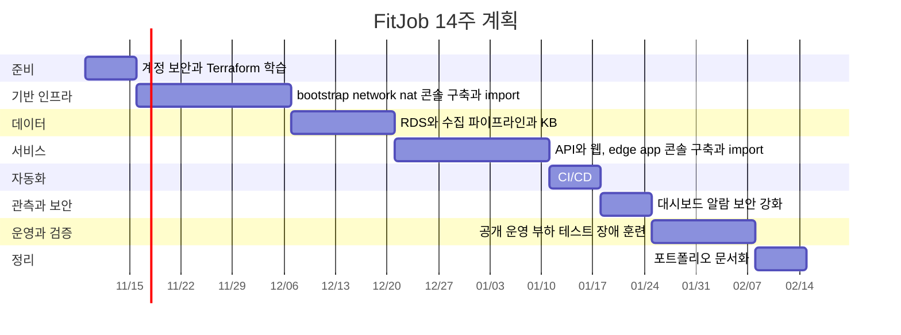

# 09. 로드맵 · 일정

| 항목 | 내용 |
|---|---|
| 문서 버전 | v0.2 |
| 작성일 | 2026-11-02 |
| 변경 | 개발 기간 온디맨드 운영 반영 (2026-11-02) |
| 변경 | 기존 문제 수정: DB 관리 작업 접속, E2E·보안 회귀 워크플로, RAG 평가 방식 (2026-11-02) |
| 변경 | 수집 전용(`collect_only`) 모드 추가, Phase 2 RDS 상시 이유 명시 (2026-11-02) |
| 변경 | 콘솔 구축 후 Terraform으로 가져오는 방식(ADR-012), 일정 12주 → 14주 (2026-11-02) |
| 변경 | Phase 0에 WSL 개발 환경 구성 추가 (2026-11-03) |
| 변경 | Phase 2 DB 접속용 임시 EC2 추가, Phase 3에서 삭제 (2026-11-03) |
| 변경 | W0 API 신청 현황, 두 번째 소스 변경(ADR-013) (2026-11-03) |
| 변경 | W0 공공기관 채용정보 API 키 활성화 확인 (2026-11-03) |
| 변경 | Phase 0에 S3 Vectors 필터 실측(Q-05) 추가, 위험 R-10 추가 (2026-11-03) |
| 변경 | Phase 0 S3 Vectors 필터 실측에 빈 목록 메타데이터 추가 (2026-11-04) |
| 변경 | Phase 0 WSL 개발 환경 행에 설치 스크립트 `scripts/setup-wsl.sh` 연결, 도구 설치는 W0에 끝냄 (2026-11-04) |
| 변경 | Q-06 확인 결과 반영: Phase 0·2 행, 위험 R-05 (2026-11-04) |
| 변경 | Phase 0 저장소 행: 모든 텍스트 파일 LF 고정, 공개 저장소로 결정 (2026-11-04) |
| 변경 | Phase 0 표에 상태 열과 하네스 행 추가, 7장 완료 기록 추가 (2026-11-04) |
| 가정 | 1인, 주 15~20시간, 2026-11-09(월) 시작, 14주 (콘솔 구축 후 Terraform으로 가져오는 방식이라 Phase 1·3을 1주씩 늘림) |

> 주당 투입 시간이 정해지면 일정을 다시 맞춘다([요구사항 Q-07](01-requirements.md#9-미결-사항-구현-전-확인)).

---

## 1. 지금 바로 할 일 (W0)

| 할 일 | 이유 |
|---|---|
| 사람인 채용정보 API 키 신청 | 승인까지 시간이 걸릴 수 있음. 2026-11-03 심사 중 |
| 공공데이터포털 공공기관 채용정보 조회서비스 활용신청 | 고용24는 개인 신청으로 채용정보를 받을 수 없어 대체([ADR-013](10-adr.md#adr-013-두-번째-수집-소스로-공공기관-채용정보-조회서비스를-쓴다)). 2026-11-03 개발 계정 승인, 같은 날 키 활성화 확인(진행 중 공고 527건) |
| AWS Budgets 월 $100 알림 설정 | 기존 계정은 무료 크레딧이 없음. 지금은 콘솔로 만들고, Phase 1에서 `bootstrap` 스택으로 가져온다(`terraform import`). 2026-11-04 만든 것 확인 |

## 2. 전체 일정

| 단계 | 기간 | 주차 | 운영 방식 | 월 예상 비용 |
|---|---|---|---|---|
| Phase 0 준비 | 11/09 ~ 11/15 | W1 | 상시 스택만 | 약 $5 |
| Phase 1 기반 인프라 | 11/16 ~ 12/06 | W2~4 | 상시 스택 + `nat`는 작업할 때만 | 약 $5 |
| Phase 2 데이터 파이프라인 | 12/07 ~ 12/20 | W5~6 | RDS 상시, `nat`(DB 접속용 임시 EC2 포함)는 작업할 때만 | 약 $25~30 |
| Phase 3 API·웹 | 12/21 ~ 2027/01/10 | W7~9 | 온디맨드 (하루 4시간 작업 기준) | 약 $15~35 |
| Phase 4 CI/CD | 01/11 ~ 01/17 | W10 | 온디맨드 | 약 $15~35 |
| Phase 5 관측·보안 | 01/18 ~ 01/24 | W11 | 온디맨드 | 약 $15~35 |
| Phase 6 운영·검증 | 01/25 ~ 02/07 | W12~13 | 24시간 운영, 앱 서버 1대 | 약 $82~91 |
| Phase 7 정리 | 02/08 ~ 02/14 | W14 | 24시간 운영 후 `make down` | 약 $82~91 |
| **14주 총액** | | | | **약 $90~135** |

- 월 예상 비용은 그 운영 방식이 한 달 내내 이어진다고 할 때의 월 환산 값이다. W7~11은 RDS를 같이 끄면 $15, 계속 켜두면 $35. 운영 단계는 VPC 오리진 전환 시 약 $75~84.
- 콘솔로 만든 리소스는 가져오기 전에는 `make down`이 지우지 못한다. 만든 날 import하거나 직접 지우면 단계별 비용에 큰 차이가 없다([인프라 명세 13.2](05-infrastructure.md#132-콘솔-단계-규칙)).
- 기존 계획처럼 만든 리소스를 24시간 켜두면 14주 총액은 약 $195~210다. 계산 근거는 [아키텍처 11](02-architecture.md#11-비용-추정-서울-리전-월) 참고.

## 3. 단계별 상세

각 스택은 **콘솔로 먼저 만들고 Terraform으로 가져온다**([ADR-012](10-adr.md#adr-012-인프라를-콘솔로-먼저-만들고-terraform으로-가져온다)). 순서는 ① 콘솔 구축 → ② 코드 작성·import → ③ `plan` "No changes" → ④ 재현 확인(destroy 후 apply, 온디맨드는 `make down`·`make up`) → ⑤ 이후 코드로만 변경이다([인프라 명세 13](05-infrastructure.md#13-콘솔-구축-후-terraform으로-가져오기)). 아래 표에서 "Terraform 코드"는 ③까지 끝난 코드를 말한다.

### Phase 0 준비 (W1)

2026-11-04에 앞당겨 시작했다. 끝낸 작업은 [7장 완료 기록](#7-완료-기록)에도 남긴다.

| 작업 | 산출물 | 상태 (2026-11-04) |
|---|---|---|
| 루트 MFA, 작업용 IAM 사용자(MFA), 비용 할당 태그 활성화 | 보안 체크리스트 일부 완료 | 루트 MFA, 루트 액세스 키 없음, 작업용 사용자(MFA, 결제 정보 접근 허용) 완료. 비용 할당 태그는 `Project` 태그가 붙은 리소스(import 연습 버킷)가 생긴 뒤 |
| WSL(Ubuntu) 개발 환경: make, Terraform, AWS CLI v2, Session Manager 플러그인 설치, 작업용 IAM 사용자 자격증명을 WSL에 설정. 개발 도구는 WSL에서만 실행한다([하네스 2-1](harness.md#2-1-claude-code-권한--claudesettingsjson)) | 개발 환경, `scripts/setup-wsl.sh` | 완료. Terraform 1.17.1, AWS CLI 2.39.3, Session Manager 플러그인 1.2.896.0, Docker WSL 연동. 자격증명은 `aws login --remote`로 받는 임시 자격증명이고 액세스 키는 없다([인프라 명세 5.2](05-infrastructure.md#52-cicd-역할-github-oidc)) |
| GitHub 저장소 생성(공개. 무료 플랜의 비공개 저장소는 `prod` 환경 승인을 쓸 수 없음), 이 문서 세트 커밋. `.gitattributes`와 `.editorconfig`로 모든 텍스트 파일의 줄 끝을 LF로 고정(Windows 방식 CRLF로 바뀌면 WSL bash에서 `$'\r'` 오류, `terraform fmt -check` 실패) | 저장소 | 완료. [soyeun0327/fitjob](https://github.com/soyeun0327/fitjob). OIDC 신뢰 조건이 대소문자를 구분해 저장소 이름은 소문자로 맞췄다. `main` 브랜치 보호는 설정 예정 |
| 하네스 Phase 0: 권한 설정, 문서 링크 검사 스크립트와 `*.md` 훅([하네스 7](harness.md#7-단계별-구축-순서)) | `.claude/settings.json`, `scripts/check_doc_links.py` | 완료 |
| Terraform 기초(provider, resource, variable, output, state, `import` 블록). 연습: S3 버킷 하나를 콘솔로 만들고 import해 `plan` "No changes"까지 맞춘 뒤 Terraform으로 지우기 | 학습 노트 | 남음 |
| Bedrock 모델 접근 활성화, 서울 리전에서 Haiku 5.5·임베딩 모델 호출 확인 | Q-03, Q-04 답 | 남음 |
| Terraform 프로바이더의 S3 Vectors·KB 지원 확인 | Q-06 답 | 완료. 프로바이더 6.71.0이 지원 |
| S3 Vectors를 쓰는 KB의 필터 실측: 목록 필터(`listContains`·`equals`·`in`), `andAll`·`orAll` 조건 6개와 2단계 중첩, 키가 없는 문서, 빈 목록(`[]`) 메타데이터(받아주는지, 목록 필터에서 빠지는지). 테스트 문서 10개로 하고 리소스는 같은 날 지운다(비용 1센트 미만). 문서 확인 결과는 [API 명세 5.2](04-api-spec.md#52-조건--필터-변환) | Q-05 답, 필터 구조 확정 | 남음. Q-04(임베딩 모델) 다음에 한다 |

**완료 기준:** Budgets 알림 메일 수신 확인, 미결 사항 Q-03~Q-06 답을 요구사항 문서에 기록, WSL에서 `make --version`·`terraform version`·`aws sts get-caller-identity` 성공

- 2026-11-04 현재: WSL 명령 3개 성공(`soyeun-admin`, `ap-northeast-2`), Q-06 기록. 남은 것은 Budgets 알림 메일 확인과 Q-03~Q-05다.

### Phase 1 기반 인프라 (W2~4)

| 작업 | 산출물 |
|---|---|
| `bootstrap`: state 버킷, GitHub OIDC 공급자, AWS Budgets(W0에 만든 것), 공용 SNS 토픽을 콘솔로 만들고 import. 처음에는 로컬 state로 가져온 뒤 S3 백엔드로 옮김 | Terraform 코드 |
| `network`: VPC, 서브넷 6개, 라우팅 테이블 3개, IGW, S3 게이트웨이 엔드포인트, 보안 그룹 전부를 콘솔로 만들고 import. 다른 스택을 만들기 전에 destroy 후 apply로 재현 확인 | Terraform 코드 |
| `nat`: EC2로 NAT 인스턴스를 직접 구성(소스/대상 확인 끄기, user data)하고 `rt-app` 기본 경로 추가 → import | user data, Terraform 코드 |
| Makefile `up`·`down`(이 시점에는 `nat`만, 아직 없는 스택은 건너뜀), `nightly-down` 워크플로와 `fitjob-gha-env-down` 역할 | Makefile, 워크플로 |
| 검증용 프라이빗 EC2를 띄워 SSM 접속, NAT 경유 외부 통신 확인 후 삭제 | 검증 기록 |

온디맨드 스택을 처음 만드는 시점이라, 끄는 걸 잊는 사고를 막는 안전장치(Makefile, nightly-down)를 먼저 둔다([ADR-011](10-adr.md#adr-011-개발-기간에는-비싼-리소스를-온디맨드로-운영한다)). import가 처음이라 이 단계를 3주로 잡았다.

**완료 기준:** 프라이빗 EC2의 외부 IP = NAT 퍼블릭 IP, `bootstrap`·`network`·`nat` 모두 `plan` "No changes", `network` destroy 후 apply 재현 성공, `make up`·`make down`으로 `nat`를 켜고 끄기 확인, `nightly-down` 수동 실행 성공, `ManagedBy=console` 태그가 남은 리소스 0개

### Phase 2 데이터 파이프라인 (W5~6)

| 작업 | 산출물 |
|---|---|
| `storage`: 데이터 버킷, 시크릿(틀만), S3 Vectors, KB, ECR을 콘솔로 만들고 import. S3 Vectors·KB는 프로바이더가 지원한다(Q-06). import가 막히는 부분만 CLI 스크립트로 보완 | Terraform 코드 |
| `database`: DB 서브넷 그룹, 파라미터 그룹, RDS를 콘솔로 만들고 import. 데이터를 넣기 전에 destroy 후 apply로 재현 확인. DB 사용자 분리, DB 주소 SSM 파라미터. **이 단계 동안 RDS는 계속 켜둔다**(`rds_ephemeral = false`, 삭제 보호 켬). 마감 처리, 수집 건수 7일 평균 비교, 중복 병합처럼 여러 날의 DB 상태가 이어져야 확인되는 로직을 만드는 단계라서다([인프라 명세 8.1](05-infrastructure.md#81-rds-postgresql)) | Terraform 코드 |
| `nat`에 DB 접속용 임시 EC2 추가(콘솔로 만들고 import). Phase 3에 앱 서버가 생길 때까지 DB 사용자 생성·마이그레이션·조회는 이 EC2를 거친 SSM 포트 포워딩으로 한다([인프라 명세 8.5](05-infrastructure.md#85-db-접속용-임시-ec2-phase-2)) | Terraform 코드 |
| Alembic 초기 마이그레이션 ([DB 스키마](03-db-schema.md)) | 마이그레이션 |
| 먼저 승인된 소스 1곳의 수집·정규화(품질 규칙, 픽스처 테스트)·적재·마무리 Lambda | 파이프라인 코드 |
| `pipeline`: Step Functions(`full`·`collect_only`·`replay` 모드, 콘솔 Workflow Studio로 설계한 뒤 정의 JSON을 코드로), Scheduler(`schedule_mode = collect_only`) → import. Lambda 코드는 처음부터 저장소에서 패키징 | `pipeline` 스택 |

**완료 기준:** `nat`·`storage`·`database`·`pipeline` 모두 `plan` "No changes", `collect_only` 예약 실행 3일 연속 성공, 그 3일치를 날짜 순서대로 replay해 적재·마감·중복 처리 확인, `full` 수동 실행 1회 성공, CLI로 KB `Retrieve`에 메타데이터 필터를 걸어 조건에 맞는 결과 확인. `full` 예약 실행은 Phase 6에서 운영 구성으로 바꿀 때 검증한다(개발 중에는 NAT가 03:00에 꺼지기 때문).

### Phase 3 API·웹 (W7~9)

| 작업 | 산출물 |
|---|---|
| FastAPI: 공고 목록·상세, 메타, 세션, 채팅(조건 추출 → KB → RDS 재확인 → 대체 응답), 피드백. 로컬(docker compose + `BEDROCK_MODE=stub`)에서 개발 | API 코드, `openapi.json` |
| Docker 이미지를 ECR(`storage` 스택)에 푸시 | Dockerfile |
| 도메인 구매 (ALB 인증서와 `origin` 레코드에 필요하므로 `edge`·`app`보다 먼저). 구매하면 생기는 호스팅 영역은 `edge`로 import | 도메인 |
| `edge`: ACM 2개(DNS 검증 레코드 포함), CloudFront, OAC, 오리진 보호를 콘솔로 만들고 import | Terraform 코드 |
| `app`: 대상 그룹, ALB, 리스너 규칙, 시작 템플릿, ASG(1/1/4), `origin.<도메인>` 레코드를 콘솔로 만들고 import. Makefile `up`·`down`에 `database`·`app` 추가. 앱 인스턴스로 DB에 접속되는 것을 확인한 뒤 `nat` 스택의 DB 접속용 임시 EC2 삭제 | Terraform 코드 |
| 웹: 목록·상세·채팅 화면(최소 기능) | 웹 코드 |
| (선택) 파이프라인이 안정됐으면 `rds_ephemeral = true`로 바꿔 RDS도 `make up`·`make down`에 포함 (W7~11 월 약 $35 → $15) | 설정 변경 |

리소스가 가장 많은 `app`과 설정이 큰 `edge`를 콘솔로 만들고 가져와야 해서 이 단계를 3주로 잡았다.

**완료 기준:** `https://app.<도메인>`에서 채팅 동작, ALB 직접 접근이 차단됨, `edge`·`app` `plan` "No changes", `make down` 후 `make up`으로 다시 띄워 채팅 동작 확인, `fitjob-prod-db-access` 인스턴스 없음

### Phase 4 CI/CD (W10)

| 작업 | 산출물 |
|---|---|
| OIDC 역할, 워크플로 9종 ([CI/CD](06-cicd.md#3-워크플로-목록). `nightly-down`은 Phase 1, `e2e`·`security-smoke`는 Phase 5) | 워크플로 |
| 배포·마이그레이션(SSM 포트 포워딩)·롤백·스모크 스크립트. `app` 스택이 꺼져 있을 때 빌드·태그 갱신만 하는 분기 포함 | `scripts/` |
| RAG 평가 스크립트의 프롬프트 모드·전체 모드 ([테스트 전략 5.3](07-test-plan.md#53-실행-방식)) | `tests/rag-eval/` |
| 일부러 실패하는 이미지로 롤백 검증(GD-06) | 훈련 보고서 |

**완료 기준:** PR 병합만으로 앱·웹·인프라 배포, 롤백 1회 성공

### Phase 5 관측·보안 (W11)

| 작업 | 산출물 |
|---|---|
| CloudWatch 에이전트, EMF 지표. 대시보드, 알람, us-east-1 SNS, Route 53 헬스체크는 콘솔로 만들고 import | `observability` 스택 |
| deep 헬스체크, 호출 제한, 일일 상한 | 앱 코드 |
| checkov 지적 사항 해결, 보안 회귀 스모크 스크립트와 `security-smoke` 워크플로 | 보안 체크리스트 완료 |
| Playwright E2E 시나리오와 `e2e` 워크플로 | `tests/e2e/` |
| CloudFront VPC 오리진으로 ALB 내부 전환 검토(월 약 -$7, [ADR-009](10-adr.md#adr-009-cloudfront-단일-도메인으로-웹과-api를-제공하고-alb를-보호한다)) | 검토 결과, 필요하면 ADR |

**완료 기준:** `observability`를 켠 상태에서 모든 알람을 한 번씩 발생시켜 메일 수신 확인(확인 후 운영 단계 전까지 다시 끈다)

### Phase 6 운영·검증 (W12~13)

시작할 때 운영 구성으로 전환한다([인프라 명세 12.3](05-infrastructure.md#123-운영-규칙)): ASG 1/1/4, `schedule_mode = full`, `observability` 켜기, `rds_ephemeral = false`(개발 중 `true`로 바꿨다면 백업·삭제 보호를 다시 켬), 저장소 변수 `NIGHTLY_DOWN = off`, `ENV_PHASE = ops`. 앱 서버 2대(2/2/4)는 부하 테스트·장애 훈련 기간에만 쓴다. 24시간 운영은 3~4주 이어간다(W12~14, 필요하면 Phase 7 이후까지).

| 작업 | 산출물 |
|---|---|
| 공개 운영 시작, 2주간 SLO 지표 수집 | 운영 지표 |
| 자동 예약 수집 첫 검증(3일 연속 성공) | 수집 이력 |
| RAG 평가셋 50개, 매일 자동 실행 | 평가 결과 추이 |
| 부하 테스트 L-01~L-03, 스케일링 지표 조정 | 부하 테스트 보고서, ADR 갱신 |
| GD-01a → fck-nat 전환 → GD-01b, GD-02~GD-05 | 훈련 보고서 |
| 두 번째 소스 추가, 중복 병합 확인 | 파이프라인 확장 |

**완료 기준:** 2주 운영 지표 확보, 훈련 보고서 6건 이상

### Phase 7 정리 (W14)

| 작업 | 산출물 |
|---|---|
| AWS 아이콘으로 아키텍처 이미지 제작, README 정리 | README |
| 비용 리포트(월별, 절감 조치 효과) | `docs/cost-log.md` |
| ADR 최종 정리, 회고 글 | 블로그 |
| 2분 데모 영상 | 영상 |
| 운영 종료 후 `make down`, 다시 `make up`으로 재현 시간 측정·기록 후 `make down`. `NIGHTLY_DOWN = on`, `ENV_PHASE = dev`로 되돌림 | 재현 시간 기록 |
| 이력서 문장 작성(측정값 반영) | 이력서 |

## 4. 포트폴리오 기록 체크리스트

진행하면서 바로 남겨야 나중에 다시 만들지 않아도 된다.

| 시점 | 남길 것 |
|---|---|
| 매 단계 | 콘솔 구축 화면 캡처, import 직후 `plan` 차이와 맞춘 뒤 "No changes" 결과, 콘솔이 자동으로 만든 리소스 목록, 결정 사항은 ADR에 추가 |
| Phase 1 | NAT 경유 통신 확인 화면, 라우팅 테이블, nightly-down 실행 기록 |
| Phase 2 | 품질 이슈 통계, 첫 수집 건수 |
| Phase 3 | CloudFront 우회 차단 확인(ALB 직접 접근 실패 화면) |
| Phase 4 | 배포 파이프라인 실행 화면, 롤백 소요 시간 |
| Phase 6 | 부하 테스트 그래프(인스턴스 수 변화), 훈련 전후 복구 시간 비교, 평가 지표 |
| Phase 7 | `make up` 재현 소요 시간 |
| 매월 | 비용 내역(단계별 예상과 실제 비교) |

## 5. 이력서 문장 초안

측정값(X, Y, Z)은 운영 후 채운다.

- CloudFront·ALB·EC2 Auto Scaling·RDS 기반 서비스를 Terraform 스택 9개로 구축하고, GitHub Actions OIDC로 장기 키 없는 무중단 배포 구성
- AWS 콘솔로 구축한 인프라 리소스 N개를 Terraform `import`로 코드화하고, destroy·apply로 코드만으로 재현되는지 검증
- Terraform 스택을 상시·온디맨드로 분리해 개발 기간 월 비용을 약 $95에서 $15~35로 절감, 명령 한 번으로 약 20분 안에 전체 인프라 재현
- NAT Gateway 대신 NAT 인스턴스를 채택해 월 $X 절감, 장애 훈련으로 단일 장애점의 복구 시간을 Y분에서 Z분으로 단축(fck-nat 자동 복구)
- LLM 조건 추출과 벡터 검색의 메타데이터 필터를 결합해 평가셋 50개에서 조건 위반 추천 0건 달성
- k6 부하 테스트로 Auto Scaling 확장 시간을 측정하고 스케일링 기준을 데이터로 조정
- 외부 API 데이터에 품질 규칙 11종과 계약 테스트를 적용해 API 장애 시 대량 오마감을 방지

## 6. 위험 관리

| ID | 위험 | 가능성 | 영향 | 대응 |
|---|---|---|---|---|
| R-01 | API 승인 지연·거절 | 중 | 높음 | 공공기관 채용정보·지자체 공공데이터 먼저, 픽스처로 개발 병행. 사람인이 거절되면 공공기관 채용정보가 첫 번째 소스([ADR-013](10-adr.md#adr-013-두-번째-수집-소스로-공공기관-채용정보-조회서비스를-쓴다)) |
| R-02 | Terraform 학습 시간 | 높음 | 중 | Phase 0에 import까지 연습, 콘솔로 먼저 익히고 가져오기([ADR-012](10-adr.md#adr-012-인프라를-콘솔로-먼저-만들고-terraform으로-가져온다)), Phase 1·3에 1주씩 여유, 모듈은 이해한 뒤 사용 |
| R-03 | 예산 초과 | 중 | 중 | 온디맨드 운영([ADR-011](10-adr.md#adr-011-개발-기간에는-비싼-리소스를-온디맨드로-운영한다)), nightly-down, `bootstrap`의 Budgets 알림 |
| R-04 | 서울 리전에서 모델·기능 미지원 | 중 | 중 | 교차 리전 추론 프로필, 대체 임베딩 모델 |
| R-05 | Terraform 미지원 리소스 | 낮음 | 낮음 | Q-06 확인 결과 S3 Vectors·KB 모두 지원(프로바이더 6.71.0). 그래도 막히는 부분만 CLI 스크립트, 문서화 |
| R-06 | API 약관상 저장·표시 제한 | 중 | 높음 | 약관에 맞춰 저장 필드 축소, 원문 링크 중심 표시 |
| R-07 | 일정 지연 | 높음 | 중 | P1·P2 기능을 미루고 P0와 운영 검증을 우선. import 때문에 1주 이상 더 밀리면 남은 스택은 처음부터 Terraform으로 만든다(ADR-012 재검토 조건) |
| R-08 | 콘솔로 만든 리소스 정리 누락·비용 | 중 | 낮음 | `ManagedBy=console` 태그를 붙이고, 시간당 과금 리소스는 만든 날 import하거나 직접 삭제, 매주 태그로 남은 리소스 확인 |
| R-09 | import가 어려운 리소스 | 중 | 낮음 | 마법사 대신 리소스를 하나씩 만들기, 자동 생성 리소스 목록 확인([인프라 명세 13.2](05-infrastructure.md#132-콘솔-단계-규칙)), 미지원 리소스는 CLI 스크립트 |
| R-10 | S3 Vectors를 쓰는 KB가 목록 필터나 조건 6개 이상을 지원하지 않음 | 중 | 중 | Phase 0 실측. 안 되면 순서대로 검토한다: `in`으로 바꾸고 조건을 5개씩 묶기 → 일부 조건은 RDS 재확인에만 두고 KB 후보 수 늘리기 → KB를 거치지 않고 S3 Vectors `QueryVectors` 직접 호출. 그래도 조건 위반이 생기면 pgvector 재검토([ADR-002](10-adr.md#adr-002-벡터-저장소로-bedrock-knowledge-base--s3-vectors를-쓴다) 재검토 조건) |

## 7. 완료 기록

로드맵 표의 작업을 끝내면 여기에 남긴다. CLAUDE.md를 100줄 안으로 유지하려고 CLAUDE.md 대신 이 문서에 둔다. 콘솔에서만 한 작업은 커밋 칸을 비운다.

| 날짜 | Phase | 작업 | 커밋 |
|---|---|---|---|
| 2026-11-04 | 0 | 저장소 기본 설정: `.gitattributes`·`.editorconfig`(LF 고정), `.gitignore` | `46c5365` |
| 2026-11-04 | 0 | WSL 개발 도구 설치 스크립트와 설치(make, Terraform, AWS CLI, Session Manager 플러그인) | `c8d2452` |
| 2026-11-04 | 0 | 하네스 Phase 0: `.claude/settings.json` 권한, 문서 링크 검사 스크립트와 `*.md` 훅 | `a0892f7` |
| 2026-11-04 | 0 | 설계 문서 세트 v0.2 커밋, Q-06 확인, GitHub 공개 저장소 `soyeun0327/fitjob`에 푸시 | `2f41cb4` |
| 2026-11-04 | 0 | 계정 보안: 루트 MFA, 작업용 IAM 사용자(MFA, 결제 정보 접근 허용) | (콘솔) |
| 2026-11-04 | 0 | WSL AWS 자격증명: `aws login --remote`, `aws sts get-caller-identity` 성공 | (설정) |
